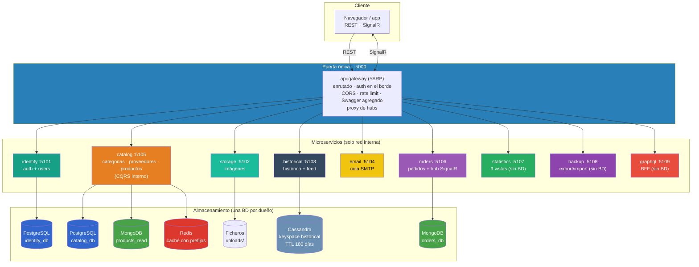
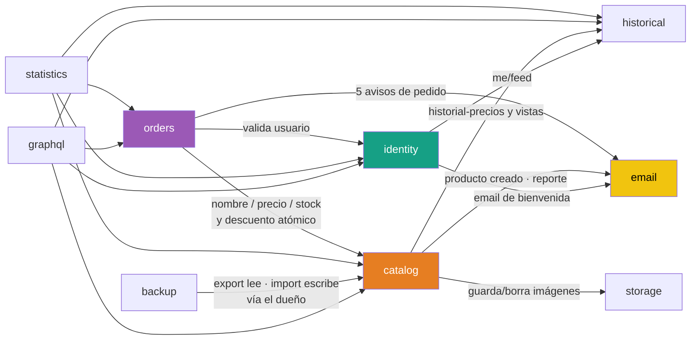
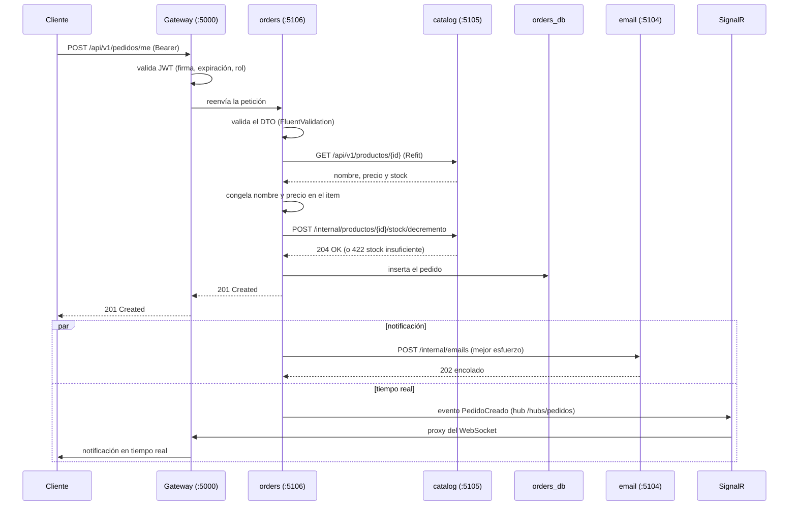
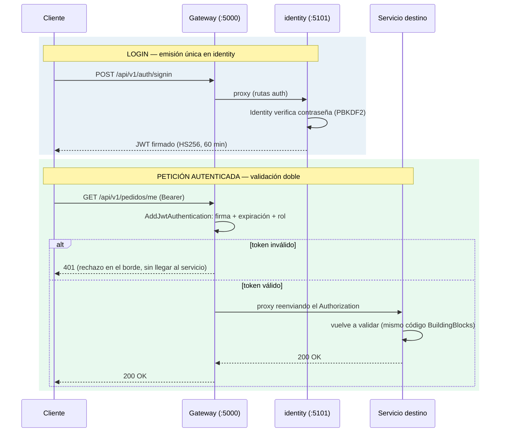

# TiendaDawApi · Microservicios + API Gateway 🛒


[](https://dotnet.microsoft.com/)
[](https://dotnet.microsoft.com/en-us/apps/aspnet)
[](https://docs.microsoft.com/en-us/dotnet/csharp/)
[](https://learn.microsoft.com/en-us/ef/core/)
[](https://microsoft.github.io/reverse-proxy/)
[](https://learn.microsoft.com/en-us/aspnet/core/security/authentication/social/)
[](https://www.docker.com/)

**Ejemplo educativo de uso de APIs para el desarrollo de servicios backend en .NET 10 ASP.NET Core y C# 14, con arquitectura de microservicios y API Gateway (YARP).**

Una API de comercio electrónico repartida en **9 microservicios + un API Gateway**, cada uno con **su propia base de datos**, comunicados entre sí con **REST (Refit)** y con el gateway como **única puerta pública**. Mismo comportamiento, mismos endpoints y las mismas suites E2E que el monolito del que procede: el cliente **no nota** el reparto.

Este proyecto es la tercera versión de la serie **TiendaDawApi**:

- [TiendaDawApi-NetCore](https://github.com/joseluisgs/TiendaDawApi-NetCore) — API REST completa (punto de partida).
- [TiendaDawApi-Cqrs-MediatR-NetCore](https://github.com/joseluisgs/TiendaDawApi-Cqrs-MediatR-NetCore) — refactor a **CQRS con MediatR** (proyecto origen de este).
- **Este proyecto** - descompone ese monolito en **microservicios + API Gateway (YARP)** conservando la misma API para el cliente.

## 🎯 Descripción

TiendaDaw API Microservicios es una serie de servicios backend desarrollados con .NET 10 ASP.NET Core y C# 14 que implementa una API RESTful completa para una tienda en línea, **repartida por subdominios**: cada microservicio es una API pequeña con sus endpoints, sus tests y su base de datos, y nadie toca los datos de otro. Un **API Gateway (YARP)** enruta, autentica en el borde, resuelve CORS/rate limit y hace de proxy de los hubs SignalR.

- 🚪 **API Gateway (YARP)**: única puerta pública; mapa de rutas por prefijo, auth en el borde, CORS, rate limit, Swagger **agregado** y proxy de hubs
- 🏪 **Catálogo**: productos, categorías y proveedores con **CQRS interno** (escritura en PostgreSQL, lectura desnormalizada en MongoDB)
- 🛒 **Pedidos**: estados con documentos embebidos en MongoDB; transacción del monolito → validación + descuento atómico en `catalog`
- 👥 **Usuarios**: autenticación **solo Identity + JWT + OAuth 2.0** (Google, GitHub, Microsoft); emisión única en `identity`, validación **doble** (gateway + cada servicio)
- 📊 **Extras portados**: estadísticas, backup/restore, feed e histórico de precios (Cassandra, TTL 180 días), imágenes, GraphQL (BFF) y notificaciones en tiempo real (SignalR)
- 🔁 **Resiliencia (Polly)**: timeout por intento, reintento por verbo y cortacircuitos **por backend** entre servicios
- 🧪 **Testing**: 794 tests (unit + integración con Testcontainers) y **4 suites E2E** (Automation, Newman, Bruno local y Bruno Docker) contra el gateway
- 🐳 **Docker de producción**: 10 Dockerfiles multi-stage, compose completo (10 servicios .NET + 4 BDs) y `.env` unificados

## 📑 Tabla de Contenidos

- [TiendaDawApi · Microservicios + API Gateway 🛒](#tiendadawapi--microservicios--api-gateway-)
  - [🎯 Descripción](#-descripción)
  - [📑 Tabla de Contenidos](#-tabla-de-contenidos)
  - [✨ Características](#-características)
  - [🚀 Tecnologías](#-tecnologías)
  - [🏃‍♂️ Inicio Rápido](#-inicio-rápido)
    - [Desarrollo Local](#desarrollo-local)
    - [Desarrollo en Producción con Docker](#desarrollo-en-producción-con-docker)
  - [🧪 Estrategia de Testing](#-estrategia-de-testing)
    - [Ejecución de Tests](#ejecución-de-tests)
      - [Comandos específicos por tipo de test](#comandos-específicos-por-tipo-de-test)
      - [Configuración de tests](#configuración-de-tests)
    - [Tests E2E con Automation, Newman y Bruno](#tests-e2e-con-automation-newman-y-bruno)
      - [Automation (Node)](#automation-node)
      - [Postman (Newman)](#postman-newman)
      - [Bruno (CLI local)](#bruno-cli-local)
      - [Bruno (Docker)](#bruno-docker)
  - [📚 Documentación](#-documentación)
    - [Fundamentos y Configuración](#fundamentos-y-configuración)
    - [API y Controllers](#api-y-controllers)
    - [Persistencia de Datos](#persistencia-de-datos)
    - [Lógica de Negocio](#lógica-de-negocio)
    - [Seguridad](#seguridad)
    - [APIs Avanzadas](#apis-avanzadas)
    - [Servicios Externos](#servicios-externos)
    - [Tareas en Segundo Plano](#tareas-en-segundo-plano)
    - [Documentación](#documentación)
    - [Testing y Calidad](#testing-y-calidad)
    - [DevOps y Producción](#devops-y-producción)
    - [Arquitectura](#arquitectura)
    - [Microservicios y Gateway](#microservicios-y-gateway)
  - [📂 Estructura del Proyecto](#-estructura-del-proyecto)
    - [Descripción de Carpetas Principales](#descripción-de-carpetas-principales)
  - [🗺️ Arquitectura de Microservicios](#-arquitectura-de-microservicios)
    - [Diagrama general](#diagrama-general)
    - [Principios del proyecto](#principios-del-proyecto)
    - [Servicios](#servicios)
    - [Comunicación interna (REST con Refit)](#comunicación-interna-rest-con-refit)
    - [Secuencia: crear un pedido](#secuencia-crear-un-pedido)
  - [🚪 API Gateway (YARP)](#-api-gateway-yarp)
    - [Mapa de rutas](#mapa-de-rutas)
  - [🔁 Resiliencia entre servicios (Polly)](#-resiliencia-entre-servicios-polly)
  - [🗄️ Estrategia Multi-Base de Datos](#-estrategia-multi-base-de-datos)
  - [🔐 Seguridad](#-seguridad)
    - [Diseño JWT: emisión única y validación doble](#diseño-jwt-emisión-única-y-validación-doble)
  - [📡 Endpoints](#-endpoints)
    - [Auth](#auth)
    - [Users](#users)
    - [Categorías](#categorías)
    - [Proveedores](#proveedores)
    - [Productos](#productos)
    - [Pedidos (Administrador)](#pedidos-administrador)
    - [Pedidos (Usuario - Mis Pedidos)](#pedidos-usuario---mis-pedidos)
    - [Estadísticas](#estadísticas)
    - [Backup](#backup)
    - [Storage (Archivos)](#storage-archivos)
    - [GraphQL](#graphql)
    - [Tiempo real (SignalR)](#tiempo-real-signalr)
    - [Endpoints internos (servicio ↔ servicio)](#endpoints-internos-servicio--servicio)
  - [🐳 Despliegue y configuración por entornos](#-despliegue-y-configuración-por-entornos)
  - [👥 Usuarios Demo](#-usuarios-demo)
  - [📝 Licencia](#-licencia)
  - [👨‍💻 Autor](#-autor)
    - [Contacto](#contacto)
  - [Licencia de uso](#licencia-de-uso)
## ✨ Características

- 🚪 **API Gateway YARP**: `ReverseProxy:Routes` por prefijo; cambiar el destino de una ruta es un `ClusterId` (cero código)
- 🧩 **Una API = un subdominio**: 9 microservicios con par `<Servicio>` + `<Servicio.Tests>` en una sola solución
- 🗄️ **Una BD por microservicio**: PostgreSQL (identity, catalog), MongoDB (read model de catalog, pedidos), Cassandra (histórico con TTL 180 días), Redis (caché con prefijos) y ficheros (storage)
- 🔌 **REST con Refit**: contrato de interfaz por cliente; sin colas, sin gRPC, sin event bus (lo que ya se conoce en 2DAW)
- 📡 **SignalR solo al navegador**: los hubs viven en el servicio dueño (`/hubs/productos` → catalog, `/hubs/pedidos` → orders) y el gateway hace de proxy — **los WebSockets puros `/ws/*` no se replican** (excepción documentada del proyecto)
- 🔐 **Solo Identity + JWT + OAuth 2.0**: sin conmutador `Auth:Mode`; emisión única en `identity` (HS256), **validación doble** en gateway y en cada servicio (`BuildingBlocks/Jwt`)
- 📄 **Swagger agregado**: el gateway fusiona el `swagger.json` de los 10 servicios en **un solo documento** en `/swagger` (misma experiencia que el monolito)
- 🔁 **Resiliencia con Polly**: timeout 10 s (lecturas) / 5 s (escrituras) por intento, reintento **por verbo** (GET reintenta; POST solo si la conexión nunca se estableció) y cortacircuitos **por autoridad** (5 fallos → 15 s sin llamar)
- 📧 **Email como servicio**: cola SMTP propia; los avisos de pedidos son **mejor esfuerzo** — un email caído **no rompe** el pedido ya guardado
- 📊 **Estadísticas sin BD**: 9 vistas ADMIN que agregan por Refit con `Task.WhenAll` reenviando el JWT del llamante
- 🗃️ **Backup sin BD**: export/import vía el dueño (`catalog`), con `dryRun`, upsert por clave e informe de errores de fila
- 🚀 **GraphQL BFF sin BD**: mismo esquema que el monolito; cada query/mutation es la llamada REST equivalente hecha por Refit
- 🐳 **Despliegue de producción**: topología en `appsettings.Production.json` (sin secretos), secretos en `.env` → compose, **solo el gateway público**
- ✅ **Paridad E2E**: la suite del monolito pasa **sin tocar aserciones** contra este proyecto (solo cambia la URL base `:5000`)

## 🚀 Tecnologías

- **.NET 10 con C# 14** - Plataforma principal
- **ASP.NET Core Web API** - Framework REST por servicio
- **YARP** - API Gateway (reverse proxy con mapa de rutas en configuración)
- **ASP.NET Core Identity** - Autenticación y autorización (registro, login, roles) + OAuth 2.0 externo
- **EF Core 10** - ORM con PostgreSQL (identity, catalog)
- **PostgreSQL 17** - Bases relacionales (`identity_db`, `catalog_db`)
- **MongoDB 7.0** - Documentos (`products_read` read model, `orders_db`)
- **Cassandra 5.0 (CassandraCSharpDriver)** - Series temporales con TTL nativo (histórico de precios y feed)
- **Redis** - Caché distribuida con prefijos por servicio (solo lectura, nunca fuente de verdad)
- **Refit** - Clientes tipados REST entre servicios (contratos de interfaz)
- **Polly 8** - Resiliencia (Retry, CircuitBreaker, Timeout) entre microservicios
- **JWT + OAuth 2.0 (Google/GitHub/Microsoft)** - Auth solo Identity
- **MediatR** - CQRS Commands/Queries/Notifications dentro de cada servicio
- **FluentValidation** - Validaciones declarativas
- **HotChocolate** - GraphQL server (BFF)
- **SignalR** - Tiempo real hacia el navegador (proxy en el gateway)
- **NUnit + Moq + Testcontainers** - Unit e integración con BDs reales
- **Newman / Bruno / Node** - 4 suites E2E (colecciones + Automation runner)
- **Swashbuckle/Swagger** - Documentación agregada por el gateway
- **Docker** - 10 Dockerfiles multi-stage + compose de producción completo
- **Serilog** - Logging estructurado por servicio

## 🏃‍♂️ Inicio Rápido

### Desarrollo Local

```bash
# Clonar repositorio
git clone https://github.com/joseluisgs/TiendaDawApi-MicroServices-ApiGateway-NetCore.git
cd TiendaDawApi-MicroServices-ApiGateway-NetCore

# Arranque completo en un solo comando (opciones mas abajo)
powershell -ExecutionPolicy Bypass -File .\Start-Api.ps1
```

#### `Start-Api.ps1` — arranque completo en un solo comando

Script incluido en la raíz del proyecto. **Por defecto (sin opciones) hace TODO**, en este orden:

1. **Para los servicios** que ya estuvieran corriendo → se parte siempre de un estado limpio y determinista.
2. **Compila** la solución completa (`dotnet build TiendaApi.slnx`, 22 proyectos) y se detiene si hay errores.
3. **Arranca Docker** si el demonio no responde (espera hasta 3 minutos a Docker Desktop).
4. **Resetea las bases de datos** con `Reset-Database.ps1`: para los contenedores, **borra los volúmenes** y los recrea con sus datos de semilla. Es la opción por defecto **a propósito**: siempre arrancas con las BDs limpias (aunque la API además siembra sus datos al arrancar).
5. **Lanza los 9 servicios uno a uno**, esperando su `/health` antes de pasar al siguiente, en este orden: `identity → storage → historical → email → catalog → orders → statistics → backup → graphql`. Antes de `historical` espera a que Cassandra acepte **`cqlsh`** de verdad (el puerto 9042 se abre antes de que el nodo sirva consultas) y, si el primer intento falla, reintenta hasta 3 veces.
6. **Lanza el gateway al final** (`:5000`) y comprueba el `/health` agregado.
7. **Resumen final**: estado, URLs, ruta de los logs y — si algún servicio no responde — las últimas líneas de su log de error.

**Opciones:**

| Comando | Qué hace |
| --- | --- |
| `.\Start-Api.ps1` | **Por defecto**: para → compila → **resetea las BDs (borra datos)** → arranca todo en orden |
| `.\Start-Api.ps1 -SinReset` | Igual pero **sin borrar las BDs**: solo levanta los contenedores si faltan y conserva los datos existentes |
| `.\Start-Api.ps1 -SinBuild` | Salta la compilación: rearranque rápido usando lo ya compilado |
| `.\Start-Api.ps1 -Parar` | **Solo detiene** los 10 servicios; no compila ni arranca nada |

```powershell
powershell -ExecutionPolicy Bypass -File .\Start-Api.ps1             # limpio (borra las BDs)
powershell -ExecutionPolicy Bypass -File .\Start-Api.ps1 -SinReset  # conserva los datos
powershell -ExecutionPolicy Bypass -File .\Start-Api.ps1 -SinBuild  # rearranque rapido
powershell -ExecutionPolicy Bypass -File .\Start-Api.ps1 -Parar     # solo detener
```

**Logs**: cada servicio escribe en `%LOCALAPPDATA%\Temp\tienda-logs\` (`<servicio>-run.log` y `<servicio>-run.err.log`); si un servicio no levanta, el script imprime el final de su log de error automáticamente.

#### Arranque manual (alternativa)

```bash
# 1) Infraestructura de bases de datos (PostgreSQL, MongoDB, Cassandra + Adminer y Mongo Express)
docker compose -f docker-compose.local.yml up -d

# 2) Compilar la solución completa (22 proyectos)
dotnet build TiendaApi.slnx

# 3) Arrancar los servicios (un proceso por puerto; cada uno siembra su BD al arrancar)
dotnet run --project Services/Identity --no-launch-profile      # :5101
dotnet run --project Services/Storage --no-launch-profile       # :5102
dotnet run --project Services/Historical --no-launch-profile    # :5103 (espera a la JVM de Cassandra: 30-60 s)
dotnet run --project Services/Email --no-launch-profile         # :5104
dotnet run --project Services/Catalog --no-launch-profile       # :5105
dotnet run --project Services/Orders --no-launch-profile        # :5106
dotnet run --project Services/Statistics --no-launch-profile    # :5107
dotnet run --project Services/Backup --no-launch-profile        # :5108
dotnet run --project Services/GraphQL --no-launch-profile       # :5109

# 4) El gateway — la única puerta pública
dotnet run --project Gateway --no-launch-profile                # :5000

# Comprobaciones
start http://localhost:5000/health      # 200 OK con el estado agregado de los servicios
start http://localhost:5000/swagger     # Swagger AGREGADO (fusiona el de los 10 servicios)
```

> **Nota:** las credenciales seed se crean automáticamente en cada servicio al arrancar
> (ver [Usuarios Demo](#-usuarios-demo)). Para un arranque limpio de las BDs:
> `.\Reset-Database.ps1` (bloquea hasta que las 5 BDs estén sanas).

> **OAuth 2.0:** para activar los logins externos, configura los `ClientId`/`Secret` con
> `dotnet user-secrets` o variables de entorno y activa los proveedores en
> `appsettings.Development.json` (`Auth:{Provider}:Enabled = true`).

### Desarrollo en Producción con Docker

`docker-compose.prod.yml` levanta **los 10 servicios .NET + las 4 bases de datos** en una red interna: **solo el gateway publica puerto**.

```bash
# Crear el .env de producción con tus variables (contraseñas, JWT_KEY, SMTP...)
cp .env.example .env
# Edita .env con tus contraseñas y configuración segura

# Construir y ejecutar todo
docker compose -f docker-compose.prod.yml up -d --build

# Comprobar
start http://localhost:5000/health

# Ver logs
docker compose -f docker-compose.prod.yml logs -f gateway

# Detener
docker compose -f docker-compose.prod.yml down
# Detener y eliminar volúmenes
docker compose -f docker-compose.prod.yml down -v
```

**Servicios incluidos:**

- **gateway** (puerto 5000): única puerta pública
- **identity, storage, historical, email, catalog, orders, statistics, backup, graphql**: solo red interna
- **PostgreSQL** (`identity_db`, `catalog_db`), **MongoDB** (`products_read`, `orders_db`), **Cassandra** (keyspace `historical`), **Redis** (caché con prefijos)

**Configuración por entornos:**

| Fichero | Papel |
| --- | --- |
| `appsettings.json` | Base (desarrollo local: `localhost:{puerto}`) |
| `appsettings.Production.json` | **Topología Docker sin secretos** (nombres de contenedor; solo lo carga Production) |
| `.env` (gitignored) | Secretos de producción → variables de entorno del compose (`Jwt__*` idénticos en todos los servicios, SMTP, OAuth) |
| `.env.example` | Plantilla de producción |
| `.env.development` | Variables para desarrollo local |

## 🧪 Estrategia de Testing

TiendaDaw API implementa una pirámide de pruebas profesional:

- **Unit Tests**: handlers CQRS, servicios y controladores — NUnit + Moq (sin dependencias)
- **Integration Tests**: bases de datos reales con **Testcontainers** (PostgreSQL, MongoDB, Cassandra)
- **E2E**: **4 suites** contra el gateway en `:5000` — Automation (Node), Newman (Postman) y Bruno (local y Docker)
- **Coverage**: indicadores con Coverlet

### Ejecución de Tests

```bash
# 🚀 Ejecutar TODOS los tests (requiere Docker ejecutándose)
dotnet test
# → 794 tests en 11 proyectos · 0 fallos
```

#### Comandos específicos por tipo de test

| Escenario | Comando | Docker |
| --- | --- | --- |
| **Solo unitarios** (rápido, sin dependencias) | `dotnet test --filter "FullyQualifiedName~Unit"` | ❌ |
| **Solo integración** (requiere servicios) | `dotnet test --filter "FullyQualifiedName~Integration"` | ✅ |
| **Todos** (unit + integración) | `dotnet test` | ✅ |

#### Configuración de tests

- **Integration Tests**: Testcontainers levanta las bases de datos reales en cada ejecución.
- **E2E**: requiere la API completa en `http://localhost:5000` y las BDs limpias (`./Reset-Database.ps1` desde la raíz del proyecto).
- **Estado de BD**: la API siembra sus datos al arrancar; si repites las suites, vuelve a ejecutar `./Reset-Database.ps1` y a arrancar los servicios para recuperar el estado semilla.
- **Modo de autenticación**: el proyecto funciona **solo en modo Identity** (JWT + OAuth 2.0); las 4 suites están validadas en ese modo.

### Tests E2E con Automation, Newman y Bruno

Pruebas end-to-end de la API. **Requisito:** la API completa levantada en `http://localhost:5000`.

#### Automation (Node)

```bash
# Chequea todos los controladores; sin instalar nada (Node 18+)
node tests/E2E/Automation/test-runner.mjs
# → 148 peticiones · OK: 148 · KO: 0 (incluye realtime SignalR)
```

Sale con código `0` si todo OK, `1` si algo falla (listo para CI).

#### Postman (Newman)

```bash
# Con Docker (recomendado; informes en reports/)
cd tests/E2E/Postman-Cli
docker compose up --build
# → 135 requests · 194 assertions · 0 fallos
```

#### Bruno (CLI local)

```bash
npm install -g @usebruno/cli
cd tests/E2E/Bruno-Local
bru run "0 - SETUP" "1 - AUTHENTICATION" "2 - CATEGORÍAS" "3 - PRODUCTOS" `
  "4 - PEDIDOS (Usuario)" "5 - PEDIDOS (Admin)" "6 - USUARIOS" "7 - STORAGE" `
  "10 - GRAPHQL CATEGORÍAS" "11 - GRAPHQL PRODUCTOS" "13 - HISTORIAL Y FEED" `
  "14 - PROVEEDORES" "15 - ESTADISTICAS" "16 - BACKUP" "17 - GRAPHQL PEDIDOS" `
  "90 - TEARDOWN" --env-file "environments/TiendaApi__NET_-_Environment.json" --delay 250
# → 131 requests (131 Passed)
```

#### Bruno (Docker)

```bash
cd tests/E2E/Bruno-Cli
docker compose up --build --abort-on-container-exit --exit-code-from bruno
# → 131 requests (131 Passed)
```
## 📚 Documentación

Para una comprensión profunda de la arquitectura y las tecnologías utilizadas, consulta los documentos en la carpeta [`doc/`](doc/) (38 guías):

### Fundamentos y Configuración
| #   | Documento                                                          | Descripción                    |
| --- | ------------------------------------------------------------------ | ------------------------------ |
| 01  | [Configuración proyectos .NET](doc/01-configuracion-proyectos-dotnet.md)  | IDEs, estructura, herramientas |
| 02  | [Arquitectura Pipeline HTTP](doc/02-arquitectura-pipeline-http.md) | Middlewares, Request/Response  |
| 03  | [Inyección Dependencias](doc/03-inyeccion-dependencias.md)         | DI Containers, Scopes          |

### API y Controllers
| #   | Documento                                             | Descripción                     |
| --- | ----------------------------------------------------- | ------------------------------- |
| 04  | [Controladores REST](doc/04-controladores-rest.md)    | Routing, Model Binding, Actions |
| 05  | [Validación en Cascada](doc/05-validacion-cascada.md) | Data Annotations, validaciones  |
| 06  | [REST Best Practices](doc/06-rest-best-practices.md)  | Convenciones REST               |

### Persistencia de Datos
| #   | Documento                                          | Descripción          |
| --- | -------------------------------------------------- | -------------------- |
| 07  | [Repository Pattern](doc/07-repository-pattern.md) | Abstracción de datos |
| 08  | [EF Core PostgreSQL](doc/08-ef-core-postgresql.md) | ORM relacional       |
| 09  | [MongoDB y Cassandra](doc/09-mongodb-cassandra.md)    | Base de documentos   |
| 10  | [Redis Caching](doc/10-redis-caching.md)           | Cache-Aside pattern  |

### Lógica de Negocio
| #   | Documento                                                  | Descripción                       |
| --- | ---------------------------------------------------------- | --------------------------------- |
| 11  | [Patrón Result](doc/11-patron-result.md)                   | Railway Oriented Programming      |
| 12  | [CQRS Commands Queries](doc/12-cqrs-commands-queries.md)   | Commands, Queries, Notifications  |
| 13  | [Servicios Negocio](doc/13-servicios-negocio.md)           | Servicios de aplicación           |
| 14  | [MediatR Eventos](doc/14-mediatr-cqrs-eventos.md)         | Pipeline Behaviors, Eventos      |
| 15  | [Pedidos y Transacciones](doc/15-pedidos-transacciones.md) | Transacciones, CQRS en pedidos   |
| 16  | [Mapeadores](doc/16-mapeadores.md)                         | AutoMapper vs extensiones         |
| 33  | [Estadísticas](doc/33-estadisticas.md)                     | Cálculo al vuelo de los datos     |
| 34  | [Backup y Restore](doc/34-backup-restore.md)               | Export/Import zip, json y csv     |

### Seguridad
| #   | Documento                                          | Descripción              |
| --- | -------------------------------------------------- | ------------------------ |
| 17  | [JWT Authentication](doc/17-jwt-authentication.md) | Manual e Identity + OAuth 2.0 |
| 18  | [Autorización Roles](doc/18-autorizacion-roles.md) | Policies, Roles          |
| 19  | [Seguridad HTTP](doc/19-seguridad-http.md)         | HSTS, HTTPS, Headers     |

### APIs Avanzadas
| #   | Documento                          | Descripción  |
| --- | ---------------------------------- | ------------ |
| 20  | [WebSockets](doc/20-websockets.md) | Tiempo real  |
| 21  | [GraphQL](doc/21-graphql.md)       | HotChocolate |

### Servicios Externos
| #   | Documento                                  | Descripción          |
| --- | ------------------------------------------ | -------------------- |
| 22  | [File Storage](doc/22-file-storage.md)     | Almacenamiento local |
| 23  | [Email Services](doc/23-email-services.md) | MailKit              |

### Tareas en Segundo Plano
| #   | Documento                                    | Descripción        |
| --- | -------------------------------------------- | ------------------ |
| 24  | [Background Jobs](doc/24-background-jobs.md) | Tareas programadas |

### Documentación
| #   | Documento                                        | Descripción         |
| --- | ------------------------------------------------ | ------------------- |
| 25  | [Documentación API](doc/25-documentacion-api.md) | Swagger, Versionado |

### Testing y Calidad
| #   | Documento                    | Descripción            |
| --- | ---------------------------- | ---------------------- |
| 26  | [Testing](doc/26-testing.md) | Unit, Integración, E2E |

### DevOps y Producción
| #   | Documento                                    | Descripción              |
| --- | -------------------------------------------- | ------------------------ |
| 27  | [Docker](doc/27-docker-ci-cd.md)             | Contenedores, pipelines  |
| 28  | [Logging](doc/28-logging.md)                 | Serilog, trazabilidad    |
| 29  | [Optimización](doc/29-optimizacion.md)       | Rendimiento              |
| 30  | [CI/CD con GitHub Actions](doc/30-ci-cd.md) | Pipelines, automatización |

### Arquitectura
| #   | Documento                                                 | Descripción                       |
| --- | --------------------------------------------------------- | --------------------------------- |
| 31  | [Clean Architecture](doc/31-clean-architecture.md)        | Capas, estructura                 |
| 32  | [Organización Program.cs](doc/32-organizacion-program.md) | Extension Methods, modularización |

### Microservicios y Gateway

| #   | Documento | Descripción |
| --- | --- | --- |
| 35  | [Arquitectura de Microservicios](doc/35-arquitectura-microservicios.md) | Topología, reglas, dueños de BD, CQRS interno, secuencia de pedido |
| 36  | [API Gateway (YARP)](doc/36-api-gateway-yarp.md) | Mapa de rutas, clusters, JWT en el borde, Swagger agregado, proxy de hubs |
| 37  | [Resiliencia (Polly)](doc/37-resiliencia-polly.md) | Timeout por intento, reintento por verbo, circuitos por autoridad |
| 38  | [Comunicación entre microservicios](doc/38-comunicacion-microservicios.md) | REST con Refit, mapa de dependencias, rutas internas, mejor esfuerzo |

## 📂 Estructura del Proyecto

```
TiendaDawApi-MicroServices-ApiGateway-NetCore/
├── TiendaApi.slnx                    # Solución única (22 proyectos)
├── docker-compose.local.yml          # BDs de desarrollo (PostgreSQL, MongoDB, Cassandra + Adminer/Mongo Express)
├── docker-compose.prod.yml           # Producción: 10 servicios .NET + 4 BDs (solo gateway público)
├── .env.example                      # Plantilla de variables de entorno (producción)
├── .env.development                  # Variables para desarrollo local
├── Reset-Database.ps1                # Reset de BDs (down -v + up + espera de salud)
│
├── BuildingBlocks/                   # Capa compartida: SOLO infraestructura
│   ├── Http/                         #   Resiliencia Refit (Polly): política por verbo y circuitos por autoridad
│   ├── Jwt/                          #   Emisión/validación JWT compartida (AddJwtAuthentication)
│   ├── Result/ · Errors/             #   Patrón Result y errores de dominio
│   └── ...
├── BuildingBlocks.Tests/             # Tests de la capa compartida
│
├── Gateway/                          # API Gateway (YARP): rutas, auth de borde, Swagger agregado, health
│   ├── Program.cs                    #   AddReverseProxy().LoadFromConfig + MapReverseProxy
│   ├── appsettings.json              #   ReverseProxy:Routes + ReverseProxy:Clusters
│   └── Infrastructures/              #   Health, Swagger agregado, middleware de borde
├── Gateway.Tests/
│
├── Services/                         # Un par por servicio: <Servicio> + <Servicio.Tests>
│   ├── Identity/        + Identity.Tests      # auth + users (Identity + JWT + OAuth)
│   ├── Catalog/         + Catalog.Tests       # productos (CQRS interno: PG → Mongo)
│   ├── Orders/          + Orders.Tests        # pedidos (Mongo) + hub SignalR
│   ├── Statistics/      + Statistics.Tests    # 9 vistas (sin BD, agrega por Refit)
│   ├── Backup/          + Backup.Tests        # export/import (sin BD)
│   ├── GraphQL/         + GraphQL.Tests       # BFF GraphQL (sin BD)
│   ├── Storage/         + Storage.Tests       # imágenes (ficheros)
│   ├── Historical/      + Historical.Tests    # histórico y feed (Cassandra)
│   └── Email/           + Email.Tests         # cola SMTP (sin BD)
│
├── tests/E2E/                        # La suite del monolito apuntando al gateway (:5000)
│   ├── Automation/                   # Runner Node (test-runner.mjs)
│   ├── Postman-Cli/                  # Colección Postman + compose de Newman
│   ├── Bruno-Local/                  # Colección Bruno para CLI local
│   └── Bruno-Cli/                    # Misma colección en Docker (usebruno/cli)
│
├── doc/                              # 38 guías técnicas (35-38: microservicios y gateway)
│
└── README.md                         # Este archivo
```

### Descripción de Carpetas Principales

| Carpeta | Propósito |
| --- | --- |
| **BuildingBlocks** | Infraestructura compartida (JWT, Result, clients Refit + resiliencia). **Nunca** dominio de un servicio |
| **Gateway** | YARP: rutas por prefijo, validación de borde, Swagger agregado, health agregado |
| **Services/** | 9 microservicios; cada uno con sus Features (CQRS), Controllers, Repositories, Validators e Infrastructures |
| **tests/E2E** | Las 4 suites E2E del monolito, apuntando al gateway |
| **doc/** | 38 guías técnicas (34 reutilizadas del monolito + 4 de microservicios) |

## 🗺️ Arquitectura de Microservicios

El proyecto implementa una **arquitectura de microservicios con API Gateway**: cada subdominio es un servicio independiente con sus endpoints, sus tests y su propia base de datos, y el gateway (YARP) es la **única puerta de entrada**. Los servicios se comunican entre sí con REST (Refit) y SignalR queda solo para el navegador. La topología resume qué servicio es dueño de qué y cómo se comunican:

### Diagrama general



### Principios del proyecto

| Principio | Detalle |
| --- | --- |
| **Una API = un subdominio** | Cada microservicio expone sus endpoints y nadie más toca sus datos |
| **Una base de datos por microservicio** | Ningún servicio consulta la BD de otro: **quien escribe un dato es su dueño** |
| **El gateway es la única puerta** | Los servicios no se exponen al exterior; las rutas `/internal/*` no son alcanzables desde fuera |
| **Sin compartir dominio** | `BuildingBlocks` solo lleva **infraestructura** (JWT, Result, clients Refit, resiliencia) — nunca modelos ni repositorios de un servicio |
| **REST entre servicios, SignalR solo al cliente** | Sin colas, sin gRPC, sin event bus: la consistencia eventual se asume y se documenta |

### Servicios

| Servicio | Responsabilidad | Endpoints | Almacén | Puerto |
| --- | --- | --- | --- | --- |
| **gateway** (YARP) | Enrutado, auth en el borde, CORS, rate limit, Swagger agregado, proxy de hubs | — | — | 5000 |
| **identity** | Auth **y** users juntos (Identity): registro, login, OAuth 2.0, perfiles, avatares, feed | `/api/v1/auth/*`, `/api/v1/users/*` | PostgreSQL `identity_db` | 5101 |
| **catalog** | Categorías + proveedores + productos con su **CQRS interno**; histórico y vistas por Refit | `/api/v1/{categorias,proveedores,productos}` | PostgreSQL `catalog_db` + MongoDB `products_read` + Redis | 5105 |
| **orders** | Pedidos (admin y `/me`), estados, hub SignalR de pedidos | `/api/v1/pedidos/*` | MongoDB `orders_db` | 5106 |
| **historical** | Histórico de precios y feed (TTL 180 días); lo consumen catalog e identity por Refit | (interno) | Cassandra | 5103 |
| **email** | Cola de envío de emails (bienvenida, pedidos, producto creado, reportes) | (interno) | — (SMTP) | 5104 |
| **statistics** | Las 9 consultas de estadísticas, **sin BD**: agrega por Refit | `/api/v1/estadisticas/*` | — | 5107 |
| **backup** | Export/import/formatos, **sin BD**: pide a catalog que escriba | `/api/v1/backup/*` | — | 5108 |
| **graphql** | BFF: mismas queries/mutations del monolito, consume por Refit | `/graphql` | — | 5109 |
| **storage** | Imágenes subidas (dueño de los ficheros) | `/storage/*`, `/images/*` | Ficheros `uploads/` | 5102 |

> **Por qué catalog es una sola pieza**: producto, categoría y proveedor tienen
> integridad referencial entre sí y el read model desnormalizado (categoría y
> proveedor embebidos) es **interno** a ese subdominio — se conserva exactamente
> como en el monolito (domain events + `updateMany` + job reparador), sin
> coordinación por red.

### Comunicación interna (REST con Refit)



Cada flecha es un **cliente Refit** (`I*Api`) registrado en el servicio llamante y
protegido con la política de resiliencia descrita más abajo. Las rutas
`/internal/*` **no se publican en el gateway**: solo son alcanzables por la red
interna.

### Secuencia: crear un pedido



> Si `email` está caído, el aviso se descarta con un `Log.Warning` (**mejor
> esfuerzo**): el pedido **no falla** (mismo criterio que el monolito).

## 🚪 API Gateway (YARP)

El gateway es la **única puerta pública** del sistema: un proceso YARP **sin
lógica de negocio ni BD** que enruta por prefijo hacia el microservicio dueño de
cada recurso. El mapa completo vive en `Gateway/appsettings.json`
(`ReverseProxy:Routes` + `ReverseProxy:Clusters`): cambiar el destino de una
ruta es un `ClusterId` (cero código).

### Mapa de rutas

| Ruta (nombre) | Prefijo YARP | Destino | Contenido |
| --- | --- | --- | --- |
| `health` | `/health` | gateway | Health **agregado** de los servicios (200 OK / 503) |
| `version` | `/version` | gateway | Versión del gateway |
| `swagger` | `/swagger/{**catch-all}` | gateway | **Swagger agregado**: fusiona el `swagger.json` de los 10 servicios en un documento |
| `auth` | `/api/{version}/auth/{**catch-all}` | **identity** | Registro, login, OAuth 2.0 |
| `users` | `/api/{version}/users/{**catch-all}` | **identity** | Gestión de usuarios y perfiles |
| `categorias` | `/api/{version}/categorias/{**catch-all}` | **catalog** | CRUD de categorías |
| `proveedores` | `/api/{version}/proveedores/{**catch-all}` | **catalog** | CRUD de proveedores |
| `productos` | `/api/{version}/productos/{**catch-all}` | **catalog** | Productos (lecturas desde el read model) |
| `pedidos` | `/api/{version}/pedidos/{**catch-all}` | **orders** | 12 endpoints (ADMIN + `/me`) |
| `estadisticas` | `/api/{version}/estadisticas/{**catch-all}` | **statistics** | 9 vistas ADMIN |
| `backup` | `/api/{version}/backup/{**catch-all}` | **backup** | Export/import zip·json·csv |
| `storage` | `/storage/{**catch-all}` | **storage** | Ficheros e imágenes |
| `images` | `/images/{**catch-all}` | **storage** | Imágenes estáticas subidas |
| `graphql` | `/graphql` y `/graphql/{**catch-all}` | **graphql** | Queries/mutations + suscripciones |
| `hubs-productos` | `/hubs/productos/{**catch-all}` | **catalog** | Hub SignalR (incluye `/negotiate`) |
| `hubs-pedidos` | `/hubs/pedidos/{**catch-all}` | **orders** | Hub SignalR (incluye `/negotiate`) |

> **Versionado por parámetro de ruta** (`/api/{version}/…`): el gateway enruta
> **por recurso** sin hardcodear la versión — si la API pasa a `v2`, solo cambian
> los servicios. Las rutas internas (`/internal/*`) **no se sirven por el
> gateway**.

```mermaid
flowchart LR
    C["Cliente<br/>REST · GraphQL · SignalR"]

    subgraph R["Rutas del gateway (:5000)"]
        R1["/api/v1/auth · /users"]
        R2["/api/v1/categorias · proveedores · productos"]
        R3["/api/v1/pedidos"]
        R4["/api/v1/estadisticas · /backup"]
        R5["/graphql · /hubs/*"]
        R6["/storage · /images"]
        R7["/health · /version · /swagger"]
    end

    C --> R

    R1 --> ID["identity :5101"]
    R2 --> CAT["catalog :5105"]
    R3 --> ORD["orders :5106"]
    R4 --> EST["statistics :5107"]
    R4 --> BKP["backup :5108"]
    R5 --> GQL["graphql :5109"]
    R5 --> CAT
    R5 --> ORD
    R6 --> STO["storage :5102"]
    R7 --> GW2["gateway (propio)"]

    style C fill:#34495e,color:#fff
    style ID fill:#16a085,color:#fff
    style CAT fill:#e67e22,color:#fff
    style ORD fill:#9b59b6,color:#fff
    style EST fill:#27ae60,color:#fff
    style BKP fill:#8e44ad,color:#fff
    style GQL fill:#e74c3c,color:#fff
    style STO fill:#1abc9c,color:#fff
```



> El diseño de autenticación (emisión única, validación doble y valores por entorno) vive en [🔐 Seguridad](#-seguridad).
## 🔁 Resiliencia entre servicios (Polly)

**El problema**: sin protección, un backend caído o colgado bloqueaba al cliente
hasta el timeout por defecto de `HttpClient` (**100 s**), y services como
`statistics` (que encadena páginas de varios dueños) lo multiplicaban.

**La solución** (`BuildingBlocks/Http/`, la resiliencia): un `DelegatingHandler` aplica
por petición la política que corresponde **según su verbo**, con circuitos
**aislados por backend** (autoridad `scheme://host:puerto`):

| Verbo | Timeout por intento | Reintento | Cortacircuitos |
| --- | --- | --- | --- |
| **GET / HEAD** | 10 s | **2 reintentos** (backoff exponencial 0,25 s → 0,5 s + jitter) ante 5xx/408/timeout/red | 5 fallos consecutivos → **15 s sin llamar** (luego reintenta en half-open) |
| **POST / PUT / DELETE** | 5 s | **Solo si la conexión nunca se estableció** (ConnectionRefused/HostNotFound/NetworkUnreachable): si el request llegó al servidor, reintentar podría duplicar stock o emails | Ídem, **por autoridad**: si cae `catalog` no se abre el circuito de `identity` |
| **4xx** | — | **Nunca**: es error de negocio; el backend está sano y los 404/422 que traducen orders/catalog deben llegar a la primera | No cuenta como fallo |

- **Sin reintento ciego en escrituras**: un timeout o un 5xx son ambiguos (el
  servidor pudo procesar el request) → no se repiten.
- **Circuitos por backend**: el estado es de cada destino; los 16 clientes Refit
  del reparto comparten el circuito de su autoridad (singleton por proceso).
- **Efecto medido**: con `catalog` caído, la primera llamada de statistics paga
  los reintentos (~9 s) y **las siguientes fallan en ~27 ms** con el circuito
  abierto (antes: hasta 100 s colgadas).

## 🗄️ Estrategia Multi-Base de Datos

**Regla: una base de datos por microservicio**, con usuario de BD propio. El
servidor físico se agrupa (pocos contenedores) para no saturar la máquina, pero
los datos están separados.

| Base de Datos | Base / keyspace | Dueño | Contenido | Tipo |
| --- | --- | --- | --- | --- |
| **🐘 PostgreSQL** | `identity_db` | identity | Users y roles (Identity) | Relacional (FK) |
| **🐘 PostgreSQL** | `catalog_db` | catalog | Categorías, proveedores, productos (FKs entre sí) | Relacional (FK) |
| **🍃 MongoDB** | `products_read` | catalog | **Read model CQRS** desnormalizado (categoría y proveedor embebidos) | Documentos |
| **🍃 MongoDB** | `orders_db` | orders | Pedidos (documento embebido con items) | Documentos embebidos |
| **🗄️ Cassandra** | keyspace `historical` | historical | Serie de precios por producto + feed de usuario (**TTL nativo 180 días**) | Partición + clustering |
| **🔴 Redis** | instancia única con prefijos (`products:`, `categories:`, `providers:`) | catalog | Caché Cache-Aside (**nunca fuente de verdad**) | Key-value |
| **📁 Ficheros** | volumen `uploads/` | storage | Imágenes | Sistema de ficheros |

**Dentro de catalog** las FKs existen (y el read model se sincroniza con domain
events + job reparador, como en el monolito); **entre servicios no hay FKs ni
joins** — la integridad la sostiene el REST y el dueño de cada dato.

**Caché**: solo cachea quien **lee mucho y escribe poco** — hoy solo `catalog`
(listados y detalle). Nadie cachea los datos de otro.

## 🔐 Seguridad

La autenticación es **solo Identity** (JWT + OAuth 2.0): sin conmutador `Auth:Mode`,
sin BCrypt/Custom. Los mismos roles `ADMIN`/`USER` que el monolito, con CORS, rate
limit y security headers resueltos en el **gateway**.

- ✅ **Emisión única**: solo `identity` firma los tokens (HS256, clave compartida por configuración)
- ✅ **Validación doble**: en el **gateway** (rechazo temprano en el borde) y en **cada microservicio** (mismo código `BuildingBlocks/Jwt`)
- ✅ **OAuth 2.0 externo**: Google, GitHub y Microsoft (configurable por entorno)
- ✅ **Rutas internas protegidas**: `/internal/*` no se sirven por el gateway
- ✅ **Validación de entrada**: FluentValidation en los DTOs y manejo global de errores con el mismo shape que el monolito
- ✅ **Mismo contrato de errores**: 400 con lista de errores, 401, 403, 404 y 409 como en el monolito

### Diseño JWT: emisión única y validación doble

- **Emisión — SOLO identity**: `JwtService.cs` firma **HS256** con la clave
  simétrica `Jwt:Key`, `issuer`/`audience` y expiración (`Jwt:ExpireMinutes`).
  Ningún otro servicio emite tokens.
- **Validación — compartida en `BuildingBlocks/Jwt`**: un único código
  (`AddJwtAuthentication`) usado por el gateway **y** por cada servicio:
  firma, issuer, audience, vida útil (`ClockSkew = 0`) y las políticas del
  monolito (`default`, `RequireAdminRole`, `RequireUserRole`, `AdminOnly`).
  Lanza al arrancar si falta la sección `Jwt` (mejor fallar que aceptar tokens
  inválidos).
- **Doble validación**: el gateway rechaza en el borde un token
  presente-pero-inválido (**401 aquí**, ni llega al servicio) y **cada servicio
  vuelve a validar** — la seguridad no depende de una sola capa.



| Entorno | Cómo se comparten los valores `Jwt` |
| --- | --- |
| **Docker (prod)** | `docker-compose.prod.yml` inyecta `Jwt__Key`, `Jwt__Issuer`, `Jwt__Audience`, `Jwt__ExpireMinutes` **a todos los servicios** desde `.env` (mismo valor para todos) |
| **Desarrollo local** | La misma sección `Jwt` en cada `appsettings.json` (valores idénticos) |

> **Nota producción (HS256 vs RS256)**: en desarrollo/tests se usa HS256 (clave
> simétrica compartida: simple y la misma config en todos los nodos). Con varios
> servicios en producción convendría **RS256**: identity firma con la privada y
> cada servicio valida con la pública — así la clave de firma nunca se reparte.
## 📡 Endpoints

> **Cómo se lee la columna Auth**: `anónimo` = sin token; `ADMIN` = requiere rol
> ADMIN; `usuario` = requiere token (cualquier rol). El contrato completo, con
los endpoints internos y las reglas transversales, se detalla en esta sección.

### Auth

| Endpoint | Método | Auth | Descripción |
| --- | --- | --- | --- |
| `/api/v1/auth/signup` | POST | anónimo | Registro (Identity) |
| `/api/v1/auth/signin` | POST | anónimo | Login → JWT |
| `/api/v1/auth/external/{provider}` | GET | anónimo | Login externo: Google, GitHub, Microsoft |
| `/api/v1/auth/external-callback` | GET | anónimo | Callback OAuth → JWT |

### Users

| Endpoint | Método | Auth | Descripción |
| --- | --- | --- | --- |
| `/api/v1/users` | GET | ADMIN | Listado con filtros y paginación |
| `/api/v1/users/{id}` | GET | ADMIN | Detalle |
| `/api/v1/users` | POST | ADMIN | Alta de usuario |
| `/api/v1/users/{id}` | PUT | ADMIN | Edición |
| `/api/v1/users/{id}` | DELETE | ADMIN | Baja |
| `/api/v1/users/{id}/avatar` | PATCH | usuario | Avatar (por id) |
| `/api/v1/users/me/profile` | GET | usuario | Mi perfil |
| `/api/v1/users/me/profile` | PUT | usuario | Edito mi perfil |
| `/api/v1/users/me/profile` | DELETE | usuario | Borro mi cuenta |
| `/api/v1/users/me/profile/avatar` | PATCH | usuario | Mi avatar |
| `/api/v1/users/me/feed` | GET | usuario | Feed de actividad (vía Refit a `historical`) |

### Categorías

| Endpoint | Método | Auth | Descripción |
| --- | --- | --- | --- |
| `/api/v1/categorias` | GET | anónimo | Listado (filtros + paginación) |
| `/api/v1/categorias/{id}` | GET | anónimo | Detalle |
| `/api/v1/categorias` | POST | ADMIN | Alta |
| `/api/v1/categorias/{id}` | PUT | ADMIN | Edición (actualiza sus productos embebidos) |
| `/api/v1/categorias/{id}` | DELETE | ADMIN | Baja |

### Proveedores

| Endpoint | Método | Auth | Descripción |
| --- | --- | --- | --- |
| `/api/v1/proveedores` | GET | ADMIN | Listado con filtros |
| `/api/v1/proveedores/{codigo}` | GET | ADMIN | Detalle por código (11 caracteres estilo YouTube) |
| `/api/v1/proveedores` | POST | ADMIN | Alta (si no se envía código, lo genera) |
| `/api/v1/proveedores/{codigo}` | PUT | ADMIN | Edición (el código es la clave) |
| `/api/v1/proveedores/{codigo}` | DELETE | ADMIN | Baja (422 si tiene productos asociados) |

### Productos

| Endpoint | Método | Auth | Descripción |
| --- | --- | --- | --- |
| `/api/v1/productos` | GET | anónimo | Listado — **lee del read model (MongoDB)** |
| `/api/v1/productos/{id}` | GET | anónimo | Detalle — **lee del read model** |
| `/api/v1/productos/categoria/{categoriaId}` | GET | anónimo | Por categoría |
| `/api/v1/productos` | POST | ADMIN | Alta (FK a categorías/proveedores) |
| `/api/v1/productos/{id}` | PUT | ADMIN | Edición |
| `/api/v1/productos/{id}` | DELETE | ADMIN | Baja |
| `/api/v1/productos/{id}/imagen` | PATCH | ADMIN | Cambio de imagen |
| `/api/v1/productos/{id}` | PATCH | ADMIN | Edición parcial |
| `/api/v1/productos/{id}/historial-precios` | GET | anónimo | Histórico (vía Refit a `historical`) |
| `/api/v1/productos/{id}/vista` | POST | usuario | Registrar vista (vía Refit a `historical`) |

### Pedidos (Administrador)

| Endpoint | Método | Auth | Descripción |
| --- | --- | --- | --- |
| `/api/v1/pedidos` | GET | ADMIN | Todos los pedidos |
| `/api/v1/pedidos/paged` | GET | ADMIN | Paginado |
| `/api/v1/pedidos/{id}` | GET | ADMIN | Detalle |
| `/api/v1/pedidos/{id}` | PUT | ADMIN | Edición |
| `/api/v1/pedidos/{id}` | DELETE | ADMIN | Baja |
| `/api/v1/pedidos/{id}/estado` | PUT | ADMIN | Cambio de evento (evento SignalR) |

### Pedidos (Usuario - Mis Pedidos)

| Endpoint | Método | Auth | Descripción |
| --- | --- | --- | --- |
| `/api/v1/pedidos/me` | GET | usuario | Mis pedidos |
| `/api/v1/pedidos/me/paged` | GET | usuario | Mis pedidos paginados |
| `/api/v1/pedidos/me` | POST | usuario | Crear pedido (Refit a catalog: nombre/precio/stock) |
| `/api/v1/pedidos/me/{id}` | GET | usuario | Mi pedido |
| `/api/v1/pedidos/me/{id}` | PUT | usuario | Edito mi pedido |
| `/api/v1/pedidos/me/{id}` | DELETE | usuario | Boro mi pedido |

### Estadísticas

> Cálculo **al vuelo** sin BD: pagina los catálogos de todos los dueños con
> `Task.WhenAll`, reenviando el JWT del llamante (los listados de usuarios y
> pedidos exigen ADMIN). **Solo ADMIN**.

| Endpoint | Método | Auth | Descripción |
| --- | --- | --- | --- |
| `/api/v1/estadisticas/resumen` | GET | ADMIN | Resumen general |
| `/api/v1/estadisticas/ventas` | GET | ADMIN | Serie temporal (`agrupar=dia\|semana\|mes`) |
| `/api/v1/estadisticas/productos-mas-vendidos` | GET | ADMIN | Ranking (`orden=unidades\|recaudacion`) |
| `/api/v1/estadisticas/categorias` | GET | ADMIN | Rendimiento por categoría |
| `/api/v1/estadisticas/proveedores` | GET | ADMIN | Rendimiento por proveedor |
| `/api/v1/estadisticas/estados` | GET | ADMIN | Embudo de estados |
| `/api/v1/estadisticas/clientes` | GET | ADMIN | Clientes con más gasto |
| `/api/v1/estadisticas/inventario` | GET | ADMIN | Valor del stock y agotados |
| `/api/v1/estadisticas/precios` | GET | ADMIN | Histórico de precios |

### Backup

> **Sin BD**: el **export** lee por las rutas públicas de catalog y el
> **import** escribe en sus endpoints internos (que hacen el upsert por clave,
> validan la fila y re-sincronizan las secuencias). `dryRun` no escribe: solo
> cuenta. Errores de fila que no abortan la operación.

| Endpoint | Método | Auth | Descripción |
| --- | --- | --- | --- |
| `/api/v1/backup/export` | GET | ADMIN | Descarga (`formato=zip\|json\|csv`, `entidades`, `incluirBorrados`) |
| `/api/v1/backup/import` | POST | ADMIN | Importación multipart (`dryRun`, `formato`) + informe |
| `/api/v1/backup/formatos` | GET | ADMIN | Catálogo de formatos, límites y reglas |

### Storage (Archivos)

| Endpoint | Método | Auth | Descripción |
| --- | --- | --- | --- |
| `/storage/{**path}` | GET | anónimo | Sirve ficheros (imágenes) |
| `/images/{**path}` | GET | anónimo | Imágenes estáticas subidas |

### GraphQL

| Endpoint | Método | Descripción |
| --- | --- | --- |
| `/graphql` | POST | Queries (productos, categorías, pedidos, users, historial, feed) y mutations de producto (ADMIN) |
| `/graphql` | GET | Playground (GraphiQL) |

**Queries disponibles:**

```graphql
# Productos y categorías (catálogo vía Refit)
productos · producto(id) · productosPaged(page, size)
categorias · categoria(id) · categoriasPaged(page, size)

# Pedidos (solo lectura: crear/editar es cosa de REST)
pedidos        # todos → SOLO ADMIN
misPedidos     # los del usuario autenticado (claim JWT)

# Mutations (requieren rol ADMIN)
createProducto(input) · updateProducto(id, input) · deleteProducto(id)
```

> ⚠️ Los pedidos **solo se leen** por GraphQL. Crear, actualizar y cancelar es
> cosa de REST (`/api/v1/pedidos...`). Los errores de negocio de catalog se
> reenvían tal cual al array `errors` de GraphQL, con el mismo texto que daría
> REST.

### Tiempo real (SignalR)

| Endpoint | Auth | Propietario | Eventos |
| --- | --- | --- | --- |
| `/hubs/productos` | broadcast | **catalog** | ProductoCreado, ProductoActualizado, ProductoEliminado |
| `/hubs/pedidos` | JWT (grupos `user-{id}` y `admins`) | **orders** | PedidoCreado, PedidoActualizado, PedidoEliminado |

- El navegador se conecta **al gateway** (`ws://localhost:5000/hubs/...`): YARP
  hace de proxy del WebSocket (incluida la negociación `/negotiate`).
- La autenticación la resuelve el **hub dueño** con el mismo JWT
  (`accessTokenFactory()` en el cliente).
- **Los WebSockets puros `/ws/*` del monolito NO se replican** (decisión del
  proyecto: solo SignalR).

### Endpoints internos (servicio ↔ servicio)

> Solo red interna; **no se publican en el gateway** (R7). El cliente nunca los usa.

| Método | Ruta | Consumidor | Acción |
| --- | --- | --- | --- |
| GET | `/internal/users/{id}` (identity) | orders | Existe y no está borrado |
| GET | `/internal/users/activos` (identity) | catalog | Usuarios activos (reporte semanal) |
| POST | `/internal/productos/{id}/stock/decremento` (catalog) | orders | Descuento atómico con validación (204/404/422) |
| POST | `/api/catalog/internal/{productos,categorias,proveedores}/import` (catalog) | backup | Upsert por clave con IDs explícitos |
| POST | `/internal/storage/files` · DELETE `?url=` (storage) | catalog | Guarda/borra imágenes |
| POST | `/internal/emails` (email) | identity, orders, catalog | Encola avisos (responde 202 y encola) |
| GET/POST | `/internal/historial/*` (historical) | catalog, identity | Serie de precios, feed y escritura del dual-write |

## 🐳 Despliegue y configuración por entornos

**Desarrollo local**: `docker-compose.local.yml` (solo BDs y utilidades de
inspección); los servicios .NET corren en la máquina con `dotnet run` y Redis se
sustituye por caché en memoria si no está disponible.

**Producción**: `docker-compose.prod.yml` — 10 Dockerfiles multi-stage, una red
interna y **solo el gateway publicando el puerto 5000**; las bases de datos
escuchan en `127.0.0.1`. Los secretos (JWT, SMTP, OAuth) viajan de `.env` a
variables de entorno del compose, **nunca** en el repositorio ni en los
`appsettings`.

| Pieza | Rol |
| --- | --- |
| `appsettings.Production.json` | Topología Docker **sin secretos** (solo lo carga Production) |
| `.env` | Secretos → variables de entorno (`Jwt__*` idénticos en todos los servicios) |
| `.env.example` | Plantilla de producción |
| `.env.development` | Variables para desarrollo local |
| `Dockerfile` (×10) | Build multi-stage por servicio, **contexto = raíz del proyecto** (comparte `Directory.Packages.props`) |

## 👥 Usuarios Demo

| Usuario | Email | Password | Rol |
| --- | --- | --- | --- |
| admin | admin@tienda.com | `Admin123!` | ADMIN |
| userdaw | userdaw@tienda.com | `Userdaw123!` | USER |

**Nota:** credenciales **unificadas** definidas en `SeedCredentials.cs` (la
misma fuente para el seeder, el mensaje de arranque y los tests) y cumplen la
política de Identity (≥8, mayúscula y dígito). Cada servicio siembra su BD al
arrancar.

**Login externo OAuth 2.0:** también puedes iniciar sesión con Google, GitHub o
Microsoft (`/api/v1/auth/external/{provider}`), activando cada proveedor en
configuración con sus `ClientId`/`Secret` (user-secrets o variables de entorno,
nunca en `appsettings.json`).

## 📝 Licencia

Este proyecto es un ejemplo educativo con fines didácticos.

## 👨‍💻 Autor

Codificado con :sparkling_heart: por [José Luis González Sánchez](https://joseluisgs.dev)

[](https://github.com/joseluisgs)
[](https://github.com/joseluisgs)

### Contacto

<p>
    <a href="https://joseluisgs.dev/" target="_blank">
        
    </a>&nbsp;
    <a href="https://github.com/joseluisgs" target="_blank">
        
    </a>&nbsp;
    <a href="https://www.linkedin.com/in/JoseLuisGSDev" target="_blank">
        
    </a>&nbsp;
    <a href="https://www.youtube.com/@joseluisgs" target="_blank">
        
    </a>&nbsp;
    <a href="https://x.com/JoseLuisGSDev" target="_blank">
        
    </a>&nbsp;
    <a href="https://www.instagram.com/joseluisgs.dev/" target="_blank">
        
    </a>
</p>

## Licencia de uso

Este repositorio está licenciado bajo **Creative Commons**. Por favor si compartes, usas o modifica este proyecto cita a su autor.

<a rel="license" href="https://creativecommons.org/licenses/by-nc-sa/4.0/deed.es"></a>
