# 27. Docker y CI/CD

## Índice

- [27.1. El Dockerfile multi-stage (uno por servicio)](#271-el-dockerfile-multi-stage-uno-por-servicio)
- [27.2. Composes: local y producción](#272-composes-local-y-producción)
- [27.3. Topología de despliegue](#273-topología-de-despliegue)
- [27.4. Configuración por entornos](#274-configuración-por-entornos)
- [27.5. Pipeline de CI](#275-pipeline-de-ci)
- [27.6. Comandos rápidos](#276-comandos-rápidos)

>
> Hay **10 Dockerfiles** (uno por servicio) y un compose
> de producción con **10 procesos .NET + 4 bases de datos**. El pipeline de
> GitHub Actions mantiene la misma estructura, pero sobre la solución completa
> (22 proyectos).

## 27.1. El Dockerfile multi-stage (uno por servicio)

Hay **10 Dockerfiles idénticos en forma**, uno por proceso: `Gateway/Dockerfile`
y `Services/{Identity,Storage,Historical,Email,Catalog,Orders,Statistics,Backup,GraphQL}/Dockerfile`.

| Imagen (build multi-stage) | Qué hace |
|---|---|
| `mcr.microsoft.com/dotnet/sdk:10.0` — **build** | `dotnet restore` (capa cacheada) → `dotnet publish Release` |
| `mcr.microsoft.com/dotnet/aspnet:10.0` — **runtime** | Solo el publish, sin SDK ni fuentes |

```dockerfile
# Contexto = RAÍZ del proyecto (no la carpeta del servicio)
EXPOSE 5000
ENV ASPNETCORE_URLS=http://+:5000
ENV ASPNETCORE_ENVIRONMENT=Production
ENTRYPOINT ["dotnet", "Catalog.dll"]
```

🎓 **Dos decisiones importantes:**

1. **`context: .` (raíz)**: cada Dockerfile compila desde la raíz del proyecto
   porque necesita los ficheros compartidos — `Directory.Packages.props`
   (versiones NuGet centralizadas), `Directory.Build.props` y `global.json`.
   Si el contexto fuera la carpeta del servicio, la compilación fallaría.
2. **Puerto interno fijo**: dentro del contenedor el servicio escucha en el
   puerto que fija su `appsettings.Production.json` (`Urls = http://+:5000`);
   el **host** solo publica el gateway. En local, en cambio, cada servicio usa
   su puerto `5101-5109`.

## 27.2. Composes: local y producción

| Fichero | Servicios | Uso |
|---|---|---|
| `docker-compose.local.yml` | postgres `5432`, mongodb `27017`, adminer `8080`, mongo-express `8081`, cassandra `9042` (healthchecks en las BD) | **Desarrollo**: solo infra; los servicios .NET corren fuera con `dotnet run` (puertos `5101-5109` + gateway `5000`) |
| `docker-compose.prod.yml` | 4 BDs + **gateway + los 9 servicios** (red interna) | **Producción**: todo contenedorizado con healthchecks, volúmenes nombrados y `.env` |

```bash
docker compose -f docker-compose.local.yml up -d          # infra de desarrollo
docker compose -f docker-compose.prod.yml up -d --build   # producción (lee .env)
docker compose -f docker-compose.prod.yml logs -f gateway
docker compose -f docker-compose.prod.yml down -v         # ⚠ borra volúmenes (datos)
```

También hay composes de **E2E en contenedor**
(`tests/E2E/Bruno-Cli/` y `tests/E2E/Postman-Cli/`): las colecciones Bruno y
Newman corren sin instalar nada en la máquina.

> **Credenciales (criterio educativo)**: el `.env` raíz está **ignorado por git**
> (credenciales reales del despliegue), `.env.example` es la plantilla de
> producción y `.env.development` va versionado con los defaults locales de
> clase. En un proyecto real, ninguna credencial vive en el repositorio.

## 27.3. Topología de despliegue

```mermaid
flowchart TB
    subgraph Host["Máquina / servidor"]
        subgraph Pub["Puerto ÚNICO expuesto"]
            GW["gateway<br/>${API_PORT:-5000}:5000"]
        end

        subgraph Net["Red interna tienda-network (sin puertos al exterior)"]
            ID["identity"]
            STO["storage"]
            HIST["historical"]
            MAIL["email"]
            CAT["catalog"]
            ORD["orders"]
            EST["statistics"]
            BKP["backup"]
            GQL["graphql"]
        end

        subgraph BDs["Bases de datos (solo 127.0.0.1)"]
            PG[("postgres<br/>identity_db · catalog_db")]
            MG[("mongodb<br/>products_read · orders_db")]
            CA[("cassandra<br/>historical")]
            RD[("redis<br/>caché con prefijos")]
        end
    end

    Cliente["Cliente"] -->|"HTTP/WS :5000"| GW
    GW --> ID & STO & HIST & MAIL & CAT & ORD & EST & BKP & GQL

    ID --> PG
    CAT --> PG
    CAT --> MG
    CAT --> RD
    ORD --> MG
    HIST --> CA

    style GW fill:#2980b9,color:#fff
    style Cliente fill:#34495e,color:#fff
    style PG fill:#3366cc,color:#fff
    style MG fill:#47a248,color:#fff
    style CA fill:#6b8fb3,color:#fff
    style RD fill:#dc382d,color:#fff
```



| Regla | Detalle |
|---|---|
| **Solo el gateway publica** | Los 9 servicios **no tienen bloque `ports:`** → inalcanzables desde fuera (solo red interna) |
| **BDs en `127.0.0.1`** | PostgreSQL, MongoDB, Redis y Cassandra escuchan solo en localhost del host |
| **Healthchecks + `depends_on`** | El gateway espera a los servicios; los servicios a sus BDs |
| **Volúmenes nombrados** | `postgres-data`, `mongodb-data`, `redis-data`, `cassandra-data`, `tienda-images` (imágenes de storage) |
| **`restart: unless-stopped`** | Los servicios vuelven solos tras un fallo |

## 27.4. Configuración por entornos

| Fichero | Papel |
|---|---|
| `appsettings.json` | Base (**desarrollo local**: `localhost:{puerto}`) |
| `appsettings.Production.json` | **Topología Docker sin secretos**: nombres de contenedor (`Services:Catalog = http://catalog:5000`) y URLs internas — solo lo carga `Production` |
| `.env` (gitignored) | Secretos de producción → variables de entorno del compose |
| `.env.example` | Plantilla de producción (versionada) |
| `.env.development` | Variables para desarrollo local (versionada) |

**Flujo de los secretos en producción:**

```
.env  ──(docker compose)──►  variables de entorno  ──►  cada servicio
        Jwt__Key, Jwt__Issuer, Jwt__Audience, Jwt__ExpireMinutes,
        POSTGRES_*, MONGO_*, SMTP_*, OAuth__*...
```

- **Los `Jwt__*` son idénticos en todos los servicios** (misma clave, mismo
  issuer): es lo que hace posible la validación doble descrita en
  [36](36-api-gateway-yarp.md).
- **Ningún `appsettings.Production.json` contiene contraseñas**: si el compose
  no puede leer `.env`, la topología sigue siendo correcta — solo faltan los
  valores sensibles (y el servicio falla al arrancar, que es lo deseable:
  **mejor fallar que arrancar con secretos por defecto**).

## 27.5. Pipeline de CI

**Fichero**: `.github/workflows/ci.yml`. **Disparadores**: `push`,
`pull_request` y `workflow_dispatch` (manual). Opera sobre la **solución
completa** (`TiendaApi.slnx`, 22 proyectos).

| Job | `needs` | Qué hace |
|---|---|---|
| **build** | — | Checkout → setup .NET → `dotnet restore` → `dotnet build --configuration Release --no-restore` → sube artefactos |
| **test** | build | `dotnet test … --filter "FullyQualifiedName~Unit"` (unit, con `XPlat Code Coverage`) → **ReportGenerator** crea el informe HTML desde `coverage.cobertura.xml` → lo sube como artefacto |
| **test-integration** | build | `dotnet test … --filter "FullyQualifiedName~Integration"` **secuencial** (Testcontainers no se paralelizan) |
| **validate-docs** | — | Instala **DocFX** → `docfx docfx.json` → sube la documentación HTML |
| **summary** | build, test, validate-docs | Comentario resumen del pipeline |

🎓 **Por qué separar unit e integration**: los unit van en paralelo (rápidos y
aislados); los integration levantan PostgreSQL/MongoDB/Cassandra **reales** con
Testcontainers y se ejecutan **en secuencia** para no pelearse por puertos y
recursos de Docker.

> En local, las **4 suites E2E** (Automation, Newman, Bruno local y Bruno
> Docker) no forman parte del workflow: se ejecutan contra la API levantada en
> `:5000` (ver [26](26-testing.md)).

## 27.6. Comandos rápidos

```bash
# Ver los flujos
gh run list                      # o la pestaña Actions de GitHub

# Local, sin CI: lo mismo que hace el pipeline
dotnet build --configuration Release
dotnet test --filter "FullyQualifiedName~Unit"
dotnet test --filter "FullyQualifiedName~Integration"   # requiere Docker

# Despliegue completo de producción
cp .env.example .env && $EDITOR .env
docker compose -f docker-compose.prod.yml up -d --build
start http://localhost:5000/health
```

---

**Ver también**: [35 · Arquitectura de microservicios](35-arquitectura-microservicios.md) ·
[36 · API Gateway (YARP)](36-api-gateway-yarp.md) ·
[26 · Testing](26-testing.md)
