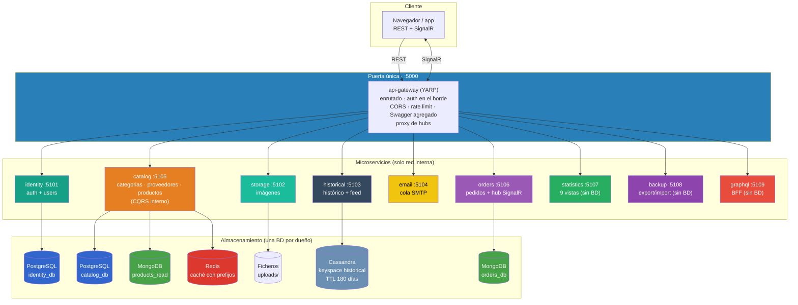
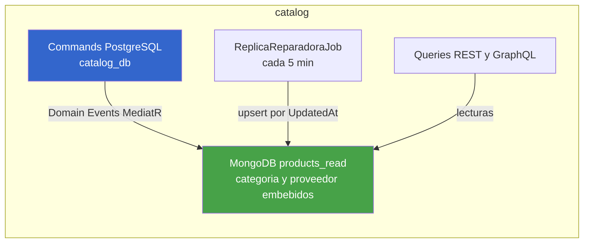
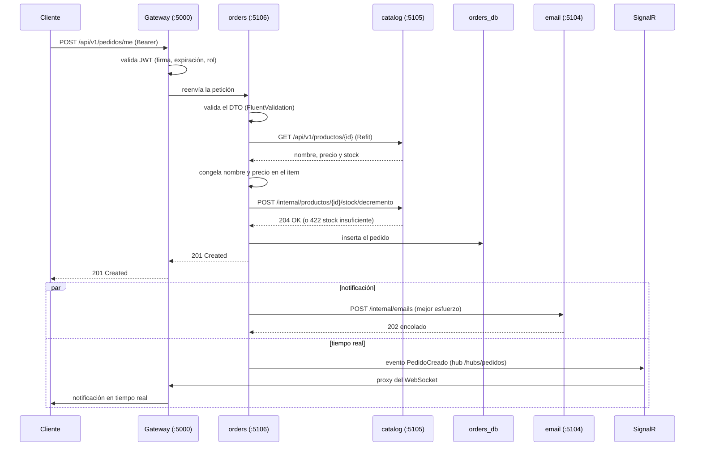

# 35. Arquitectura de Microservicios

> **Documento nuevo en la variante de microservicios.** Migra y amplía el contenido
> de `ESTRUCTURA-Y-PASOS.md` (doc interna que desaparece). Los conceptos generales
> de dominio, CQRS y tecnologías siguen siendo los de los documentos
> [31](31-clean-architecture.md) y [12](12-cqrs-commands-queries.md).

## Índice

- [35.1. Del monolito a los microservicios](#351-del-monolito-a-los-microservicios)
- [35.2. Topología general](#352-topología-general)
- [35.3. Los servicios](#353-los-servicios)
- [35.4. Reglas de la arquitectura](#354-reglas-de-la-arquitectura)
- [35.5. Bases de datos: una por dueño](#355-bases-de-datos-una-por-dueño)
- [35.6. CQRS interno dentro de catalog](#356-cqrs-interno-dentro-de-catalog)
- [35.7. Secuencia completa: crear un pedido](#357-secuencia-completa-crear-un-pedido)
- [35.8. Estructura del repositorio](#358-estructura-del-repositorio)
- [35.9. Qué queda fuera (y por qué)](#359-qué-queda-fuera-y-por-qué)

## 35.1. Del monolito a los microservicios

El proyecto origen ([TiendaDawApi-Cqrs-MediatR-NetCore](https://github.com/joseluisgs/TiendaDawApi-Cqrs-MediatR-NetCore))
es **un solo proceso** con todas las funcionalidades: catálogo, pedidos, usuarios,
estadísticas, backup… compartiendo una misma base de datos y un mismo despliegue.

Este proyecto **descompone ese monolito en microservicios** conservando la misma
API para el cliente:

| Pregunta | Respuesta |
| --- | --- |
| ¿Cambian los endpoints? | **No.** Mismas rutas, mismos códigos, mismas respuestas |
| ¿Cómo lo ve el cliente? | A través del **API Gateway** (`:5000`), como si fuera una sola API |
| ¿Y las suites E2E? | Pasan **sin tocar una sola aserción** — solo cambia la URL base |
| ¿Qué método se usa? | **Strangler** (*copiar y partir*): primero el gateway con todas las rutas apuntando al monolito, y microservicio a microservicio cada ruta cambia de destino |

> 🎓 **Por qué interesa en clase**: el reparto obliga a tomar decisiones que en el
> monolito no existían — ¿quién es dueño de cada dato?, ¿cómo se comunica un
> servicio con otro?, ¿qué pasa si un servicio se cae? Este documento contesta a
> las tres.

## 35.2. Topología general



**Lectura del diagrama**:

- El **cliente solo habla con el gateway** (`:5000`). Los microservicios escuchan
  en puertos `5101-5109` pero **no publican puertos al exterior** (solo red interna).
- Cada servicio apunta a **sus** bases de datos; nadie lee la BD de otro.
- `statistics`, `backup`, `graphql` y `email` **no tienen BD propia**: agregan o
  delegan por REST.

## 35.3. Los servicios

| Servicio | Responsabilidad | Endpoints | Almacén | Puerto |
| --- | --- | --- | --- | --- |
| **gateway** (YARP) | Enrutado, auth en el borde, CORS, rate limit, Swagger agregado, proxy de hubs | — | — | 5000 |
| **identity** | Auth **y** users juntos (Identity): registro, login, OAuth 2.0, perfiles, avatares, feed | `/api/v1/auth/*`, `/api/v1/users/*` | PostgreSQL `identity_db` | 5101 |
| **catalog** | Categorías + proveedores + productos con su **CQRS interno**; histórico y vistas por Refit | `/api/v1/{categorias,proveedores,productos}` | PostgreSQL `catalog_db` + MongoDB `products_read` + Redis | 5105 |
| **orders** | Pedidos (admin y `/me`), estados, hub SignalR de pedidos | `/api/v1/pedidos/*` | MongoDB `orders_db` | 5106 |
| **historical** | Histórico de precios y feed (TTL 180 días); lo consumen catalog e identity por Refit | (interno) | Cassandra | 5103 |
| **email** | Cola de envío de emails (bienvenida, pedidos, producto creado, reportes) | (interno) | — (SMTP) | 5104 |
| **statistics** | Las 9 consultas de estadísticas, **sin BD**: agrega por Refit | `/api/v1/estadisticas/*` | — | 5107 |
| **backup** | Export/import/formatos, **sin BD**: pide a catalog que escriba | `/api/v1/backup/*` | — | 5108 |
| **graphql** | BFF: mismas queries/mutations del monolito, consume por Refit | `/graphql` | — | 5109 |
| **storage** | Imágenes subidas (dueño de los ficheros) | `/storage/*`, `/images/*` | Ficheros `uploads/` | 5102 |

> **Por qué catalog es una sola pieza**: producto, categoría y proveedor tienen
> integridad referencial entre sí y el read model desnormalizado (categoría y
> proveedor embebidos) es **interno** a ese subdominio — se conserva exactamente
> como en el monolito (domain events + `updateMany` + job reparador), sin
> coordinación por red.

Cada servicio es un **par de proyectos** `<Servicio>` + `<Servicio.Tests>` en la
misma solución (ver [35.8](#358-estructura-del-repositorio)).

## 35.4. Reglas de la arquitectura

| Regla | Detalle |
| --- | --- |
| **Una API = un subdominio** | Cada microservicio expone sus endpoints y nadie más toca sus datos |
| **Una base de datos por microservicio** | Ningún servicio consulta la BD de otro: **quien escribe un dato es su dueño** |
| **El gateway es la única puerta** | Los servicios no se exponen al exterior; las rutas `/internal/*` no son alcanzables desde fuera |
| **Sin compartir dominio** | `BuildingBlocks` solo lleva **infraestructura** (JWT, Result, clients Refit, resiliencia) — nunca modelos ni repositorios de un servicio |
| **REST entre servicios, SignalR solo al cliente** | Sin colas, sin gRPC, sin event bus: la consistencia eventual se asume y se documenta (ver [38](38-comunicacion-microservicios.md)) |

### Consecuencias de las reglas

- **Sin FKs ni joins entre servicios**: la integridad entre subdominios la
  sostiene el REST y el dueño de cada dato. Dentro de `catalog` las FKs existen.
- **Consistencia eventual**: si catalog cambia un precio, orders lo verá en su
  próxima llamada (los pedidos congelados guardan su propio snapshot).
- **Despliegue independiente**: cada servicio se compila, testea y contenedoriza
  por separado (ver [27](27-docker-ci-cd.md)).

## 35.5. Bases de datos: una por dueño

**Regla: una base de datos por microservicio**, con usuario de BD propio. El
servidor físico se agrupa (pocos contenedores) para no saturar la máquina, pero
los datos están separados.

| Almacén | Base / keyspace | Dueño | Contenido |
| --- | --- | --- | --- |
| PostgreSQL | `identity_db` | identity | Users y roles (Identity) |
| PostgreSQL | `catalog_db` | catalog | Categorías, proveedores, productos (FKs entre sí) |
| MongoDB | `products_read` | catalog | Read model desnormalizado de productos (CQRS) |
| MongoDB | `orders_db` | orders | Pedidos (documento embebido con items) |
| Cassandra | keyspace `historical` | historical | Histórico de precios + feed (**TTL nativo 180 días**) |
| Redis | instancia única con prefijos (`products:`, `categories:`, `providers:`) | catalog | Caché (**nunca fuente de verdad**) |
| Ficheros | volumen `uploads/` | storage | Imágenes |

**Caché**: solo cachea quien **lee mucho y escribe poco** — hoy solo `catalog`
(listados y detalle de productos, categorías y proveedores). Nadie cachea los
datos de otro (ver [10](10-redis-caching.md)).

## 35.6. CQRS interno dentro de catalog

El monolito tenía el read model de productos en MongoDB con **categoría y
proveedor embebidos**. Como todo eso vive en un solo microservicio, **el patrón
se conserva idéntico** (ver [12](12-cqrs-commands-queries.md)):



- Las **lecturas de productos** responden desde `products_read` (sin joins).
- Los **renombres de categoría/proveedor** actualizan sus sub-documentos con
  `updateMany` **en proceso** (igual que el monolito: cero coordinación por red).
- El **job reparador** reconcilia por si algún evento se pierde — mismo
  mecanismo original.

> 🎓 **Diferencia clave con el monolito**: aquí el CQRS **no cruza** fronteras de
> servicio — el read model es privado de catalog. Entre servicios no hay
> "replicas sincronizadas": hay llamadas REST al dueño.

## 35.7. Secuencia completa: crear un pedido



**Los puntos que cambian respecto al monolito:**

1. **La transacción Serializable ya no existe** entre servicios: la validación de
   usuario, el snapshot del producto y el descuento de stock son **tres llamadas
   REST** con sus códigos de error (`404`, `422`). El pedido solo se guarda si
   todas pasan (ver [15](15-pedidos-transacciones.md)).
2. **El email es mejor esfuerzo**: si `email` está caído, el aviso se descarta
   con un `Log.Warning` y el pedido **no falla** (mismo criterio que el monolito).
3. **El tiempo real sale por el gateway**: el hub vive en `orders` y el gateway
   hace de proxy del WebSocket.

## 35.8. Estructura del repositorio

Una **sola solución** (`TiendaApi.slnx`, 22 proyectos); cada servicio es un par
`<Servicio>` + `<Servicio.Tests>`:

```
TiendaDawApi-MicroServices-ApiGateway-NetCore/
├── TiendaApi.slnx                    # Solución única (22 proyectos)
├── docker-compose.local.yml          # BDs de desarrollo
├── docker-compose.prod.yml           # Producción: 10 servicios .NET + 4 BDs
├── Reset-Database.ps1                # Reset de BDs (down -v + up + espera)
│
├── BuildingBlocks/                   # Capa compartida: SOLO infraestructura
│   ├── Http/                         #   Resiliencia Refit (Polly) → doc 37
│   ├── Jwt/                          #   Emisión/validación JWT compartida
│   └── Result/ · Errors/             #   Patrón Result y errores de dominio
├── BuildingBlocks.Tests/
│
├── Gateway/                          # API Gateway (YARP) → doc 36
├── Gateway.Tests/
│
├── Services/                         # Un par por servicio
│   ├── Identity/        + Identity.Tests
│   ├── Catalog/         + Catalog.Tests
│   ├── Orders/          + Orders.Tests
│   ├── Statistics/      + Statistics.Tests
│   ├── Backup/          + Backup.Tests
│   ├── GraphQL/         + GraphQL.Tests
│   ├── Storage/         + Storage.Tests
│   ├── Historical/      + Historical.Tests
│   └── Email/           + Email.Tests
│
├── tests/E2E/                        # Las 4 suites apuntando al gateway (:5000)
│   ├── Automation/                   # Runner Node
│   ├── Postman-Cli/                  # Colección + compose de Newman
│   └── Bruno-Local/ · Bruno-Cli/     # Colección Bruno (CLI y Docker)
│
└── doc/                              # Esta documentación
```

## 35.9. Qué queda fuera (y por qué)

| Tecnología | ¿Por qué no? |
| --- | --- |
| **Colas de mensajes** (RabbitMQ, Azure Service Bus) | El objetivo es que el alumno use lo que ya conoce de 2DAW; una cola añade infraestructura y teoría de consistencia fuera de alcance |
| **gRPC** | REST con Refit es suficiente y unifica el transporte: un solo estilo de llamada para todo |
| **Event bus / Sagas** | La consistencia entre servicios se resuelve con llamadas directas al dueño y se **documenta** como limitación |
| **Kubernetes** | Docker Compose cubre el despliegue educativo (ver [27](27-docker-ci-cd.md)) |

> **La contrapartida se asume y se documenta**: al no usar colas, un servicio
> caído afecta a quien lo llama — por eso existe la capa de **resiliencia**
> descrita en [37](37-resiliencia-polly.md).

---

**Siguiente**: [36 · API Gateway (YARP)](36-api-gateway-yarp.md) ·
[37 · Resiliencia (Polly)](37-resiliencia-polly.md) ·
[38 · Comunicación entre microservicios](38-comunicacion-microservicios.md)
