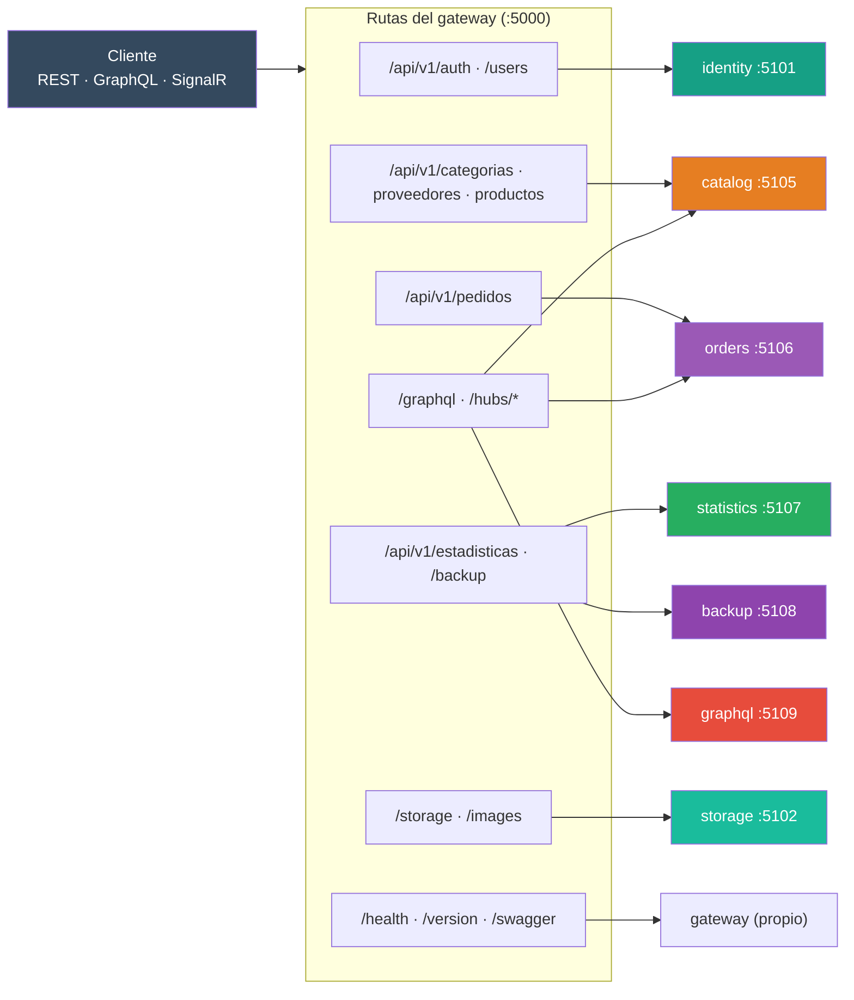
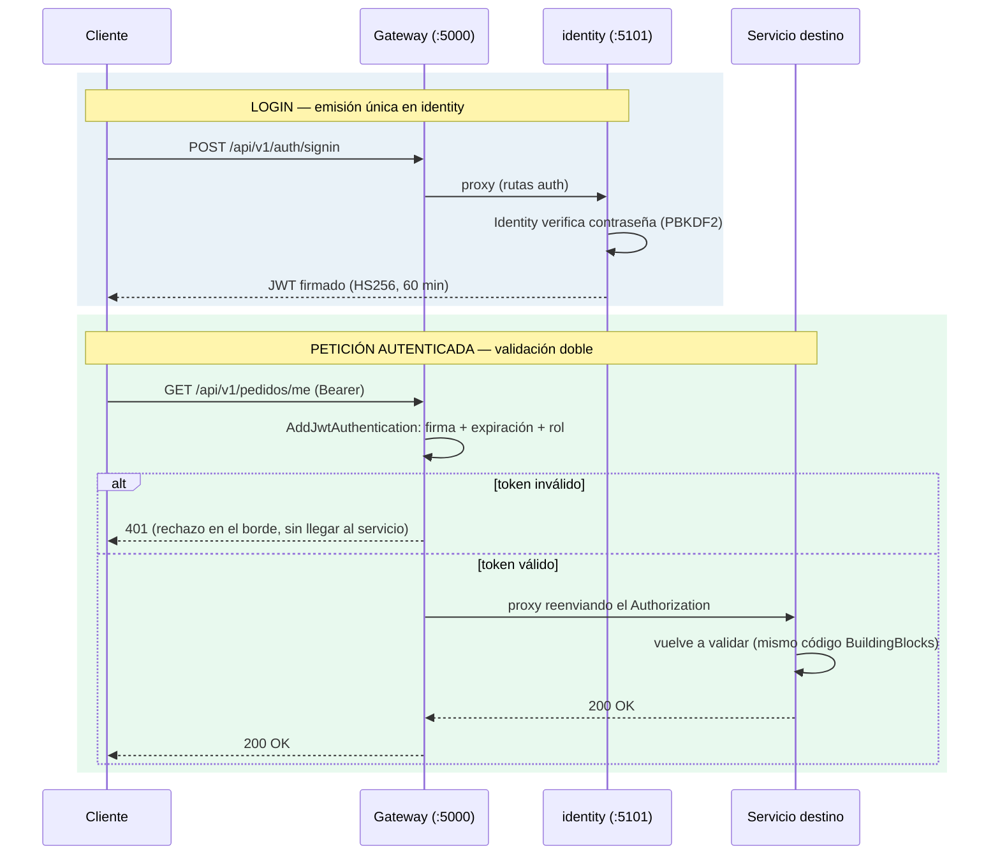

# 36. API Gateway (YARP)

## Índice

- [36.1. Qué es el gateway y por qué](#361-qué-es-el-gateway-y-por-qué)
- [36.2. Cómo funciona YARP: routes y clusters](#362-cómo-funciona-yarp-routes-y-clusters)
- [36.3. Mapa de rutas](#363-mapa-de-rutas)
- [36.4. Diagrama de enrutado](#364-diagrama-de-enrutado)
- [36.5. Diseño JWT: validación en el borde](#365-diseño-jwt-validación-en-el-borde)
- [36.6. Swagger agregado](#366-swagger-agregado)
- [36.7. Proxy de hubs SignalR](#367-proxy-de-hubs-signalr)
- [36.8. Health y version](#368-health-y-version)
- [36.9. Receta: cambiar el destino de una ruta](#369-receta-cambiar-el-destino-de-una-ruta)
- [36.10. Nota: HS256 vs RS256 en producción](#3610-nota-hs256-vs-rs256-en-producción)

> **El API Gateway de la arquitectura de microservicios.** YARP es la pieza que
> **no existía en el monolito**: sin él, el cliente tendría que conocer los
> puertos de los diez servicios.

## 36.1. Qué es el gateway y por qué

El gateway es la **única puerta pública** del sistema: un proceso **YARP**
(Yet Another Reverse Proxy) **sin lógica de negocio, sin controladores y sin
base de datos**. Solo enruta, autentica en el borde y aplica las políticas
transversales.

| Pregunta | Respuesta |
| --- | --- |
| **¿Qué enruta?** | Por **prefijo** (`/api/v1/productos/...` → `catalog`, `/api/v1/pedidos/...` → `orders`) |
| **¿Dónde vive el mapa?** | En configuración: `Gateway/appsettings.json` → `ReverseProxy:Routes` + `ReverseProxy:Clusters` |
| **¿Y el código?** | Mínimo: `Program.cs` → `AddReverseProxy().LoadFromConfig(...)` + `MapReverseProxy()` |
| **¿Puerto?** | **5000** — el único que se publica en Docker (los servicios solo red interna) |
| **¿Por qué no un Load Balancer a secas?** | Además de enrutar, resuelve CORS, rate limit, la validación JWT de borde, el Swagger agregado y el proxy de SignalR |

**Idea clave**: el mapa de rutas permite cambiar el destino de cualquier
recurso **por configuración** (una fila por recurso), de modo que migrar un
servicio no toca al cliente ni a las suites E2E.

## 36.2. Cómo funciona YARP: routes y clusters

La configuración tiene dos tablas:

```jsonc
// Gateway/appsettings.json (extracto)
{
  "ReverseProxy": {
    "Routes": {
      "productos": {
        "ClusterId": "catalog",                          // ← quién la atiende
        "Match": { "Path": "/api/{version}/productos/{**catch-all}" }
      }
    },
    "Clusters": {
      "catalog": {                                       // ← dónde está
        "Destinations": { "d1": { "Address": "http://localhost:5105" } }
      }
    }
  }
}
```

| Concepto | Qué es | Ejemplo |
| --- | --- | --- |
| **Route** | Una regla: prefijo de path → cluster | `productos` → `catalog` |
| **Cluster** | El destino físico (o varios, para balanceo) | `catalog` = `http://localhost:5105` |
| **`{version}`** | Parámetro de ruta: el gateway enruta **por recurso** sin hardcodear la versión | `/api/v2/productos` funcionará sin tocar el gateway |
| **`{**catch-all}`** | Captura todo lo que sigue (subrecursos, parámetros) | `/api/v1/productos/1/imagen` |

**Reglas de diseño:**

- **Versionado por parámetro** (`/api/{version}/…`): forma idiomática de YARP de
  no conocer la versión — mismo concepto que `v{version:apiVersion}` en los
  controllers. Una llamada a `/api/productos/…` (sin versión) **no coincide** con
  ninguna ruta, igual que en el monolito.
- **Sin catch-alls solapados**: las rutas genéricas `/hubs/{**catch-all}` y
  `/ws/{**catch-all}` se sustituyeron por rutas **específicas por recurso**
  (`hubs-productos`, `hubs-pedidos`), así dos rutas no compiten por la misma
  petición.
- **Las rutas internas no existen aquí**: `/internal/*` (servicio↔servicio)
  **no se sirven por el gateway** — solo son alcanzables por la red interna.

## 36.3. Mapa de rutas

| Ruta (nombre) | Prefijo YARP | Destino | Contenido |
| --- | --- | --- | --- |
| `health` | `/health` | gateway | Health **agregado** de los servicios |
| `version` | `/version` | gateway | Versión del gateway |
| `swagger` | `/swagger/{**catch-all}` | gateway | **Swagger agregado** (ver [36.6](#366-swagger-agregado)) |
| `auth` | `/api/{version}/auth/{**catch-all}` | **identity** | Registro, login, OAuth 2.0 |
| `users` | `/api/{version}/users/{**catch-all}` | **identity** | Gestión de usuarios y perfiles |
| `categorias` | `/api/{version}/categorias/{**catch-all}` | **catalog** | CRUD de categorías |
| `proveedores` | `/api/{version}/proveedores/{**catch-all}` | **catalog** | CRUD de proveedores |
| `productos` | `/api/{version}/productos/{**catch-all}` | **catalog** | Productos (lecturas desde el read model) |
| `pedidos` | `/api/{version}/pedidos/{**catch-all}` | **orders** | 12 endpoints (ADMIN + `/me`) |
| `estadisticas` | `/api/{version}/estadisticas/{**catch-all}` | **statistics** | 9 vistas ADMIN |
| `backup` | `/api/{version}/backup/{**catch-all}` | **backup** | Export/import zip·json·csv |
| `storage` | `/storage/{**catch-all}` | **storage** | Ficheros e imágenes |
| `images` | `/images/{**catch-all}` | **storage** | Imágenes estáticas subidas |
| `graphql` | `/graphql` | **graphql** | Queries/mutations |
| `graphql-rest` | `/graphql/{**catch-all}` | **graphql** | Suscripciones (`/graphql/ws`) |
| `hubs-productos` | `/hubs/productos/{**catch-all}` | **catalog** | Hub SignalR (incluye `/negotiate`) |
| `hubs-pedidos` | `/hubs/pedidos/{**catch-all}` | **orders** | Hub SignalR (incluye `/negotiate`) |

## 36.4. Diagrama de enrutado



## 36.5. Diseño JWT: validación en el borde

El gateway **no emite tokens** — solo valida. La emisión es **única** en
`identity` (ver [17](17-jwt-authentication.md)).



**El middleware de borde**: si llega una cabecera `Authorization: Bearer …` y **no
autentica**, el gateway responde **401 ahí mismo** — la petición no consume ni un
milisegundo del servicio. **Sin token = anónimo** (la autorización por endpoint y
roles la sigue imponiendo el destino).

| Componente | ¿Valida JWT? | Código |
| --- | --- | --- |
| **gateway** | ✅ validación de borde (rechazo temprano) | `BuildingBlocks/Jwt` + middleware propio |
| Cada servicio público | ✅ vuelve a validar con el **mismo** código | `AddJwtAuthentication` en su `Program.cs` |
| historical / email / storage | ❌ rutas internas anónimas (`/internal/*`), sin ruta en el gateway | — |

**Valores compartidos por entorno** (mismos `Jwt:*` en todos los servicios):

| Entorno | Cómo se comparten |
| --- | --- |
| **Docker (prod)** | `docker-compose.prod.yml` inyecta `Jwt__Key`, `Jwt__Issuer`, `Jwt__Audience`, `Jwt__ExpireMinutes` desde `.env` **a todos los servicios** |
| **Desarrollo local** | La misma sección `Jwt` en cada `appsettings.json` (valores idénticos) |

> **Nota SignalR**: el navegador manda el token del hub por **query string**
> (`?access_token=`), no por header — ese viaje lo valida el **servicio dueño**
> del hub, no el middleware de header del gateway.

## 36.6. Swagger agregado

En el monolito, **un solo proceso** servía el Swagger de toda la API. Repartida,
cada servicio expone **su** `swagger.json`… y el gateway **los fusiona en un solo
documento** en `/swagger`, conservando la experiencia original:

- Cada servicio conserva **su prefijo de rutas**, así que los `paths` son
  disjuntos (no hay colisiones).
- Los `schemas` **sí** pueden repetir nombre → el gateway los renombra con el
  prefijo del servicio para no pisar ninguno.
- El documento agregado se **cachea 5 minutos** y se reconstruye solo si caduca.

## 36.7. Proxy de hubs SignalR

Los hubs **viven en el servicio dueño** (`/hubs/productos` → catalog,
`/hubs/pedidos` → orders), pero el cliente solo se conecta al gateway:

```javascript
// El navegador habla SIEMPRE con el gateway
const connection = new HubConnectionBuilder()
    .withUrl("http://localhost:5000/hubs/pedidos", {
        accessTokenFactory: () => jwtToken   // el token viaja en el negotiate
    })
    .build();
```

- YARP hace de **proxy del WebSocket**, incluida la negociación `/negotiate`
  (por eso las rutas usan `{**catch-all}`).
- La autenticación la resuelve el **hub dueño** con `[Authorize]` y el mismo JWT
  (rechazo en el upgrade, como el monolito).
- **Los WebSockets puros `/ws/*` no se replican**: el proyecto usa **solo
  SignalR** (decisión documentada en el README).

## 36.8. Health y version

| Endpoint | Qué devuelve |
| --- | --- |
| `GET /health` | **Agregado**: 200 OK si todos los servicios responden, 503 si alguno cae (ej. `8/9 servicios respondiendo`) |
| `GET /version` | Versión del gateway |

Cada servicio además expone **su** `/health` en su puerto (interno, para el
agregado y para Docker).

## 36.9. Receta: cambiar el destino de una ruta

1. Añadir el **cluster** del servicio en `ReverseProxy:Clusters`
   (`"<servicio>": { "Destinations": … }`).
2. Cambiar el `ClusterId` de **sus** rutas en `ReverseProxy:Routes`.
3. Nada más: el cliente no nota nada y los E2E siguen apuntando a `:5000`.

> Es exactamente el mecanismo que usó el porte completo: **cero código** por
> servicio migrado — solo configuración.

## 36.10. Nota: HS256 vs RS256 en producción

En desarrollo y tests se usa **HS256** (clave simétrica compartida: simple, la
misma config en todos los nodos). Para producción con varios servicios
convendría **RS256** (par de claves): `identity` firma con la **privada** y cada
servicio valida con la **pública** — así la clave de firma **nunca se reparte**
(si un servicio se compromete, no puede emitir tokens). No afecta a la semántica
de claims; es un cambio de configuración del mismo flujo.

---

**Ver también**: [35 · Arquitectura de microservicios](35-arquitectura-microservicios.md) ·
[37 · Resiliencia (Polly)](37-resiliencia-polly.md) ·
[17 · JWT Authentication](17-jwt-authentication.md)
