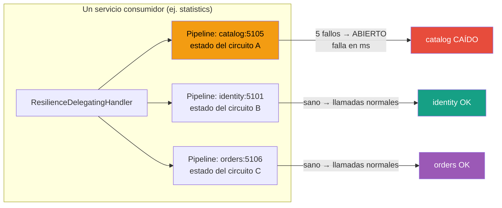
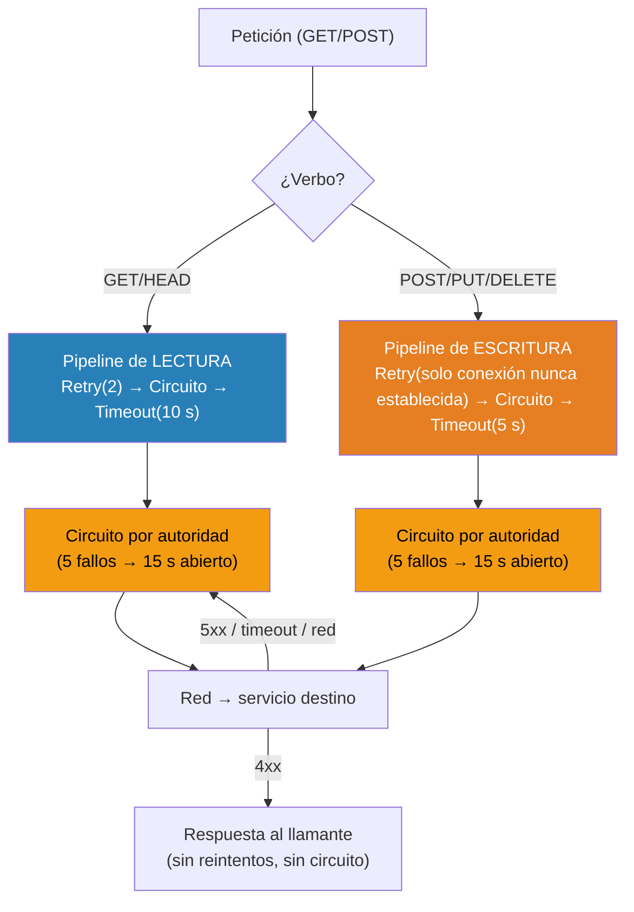
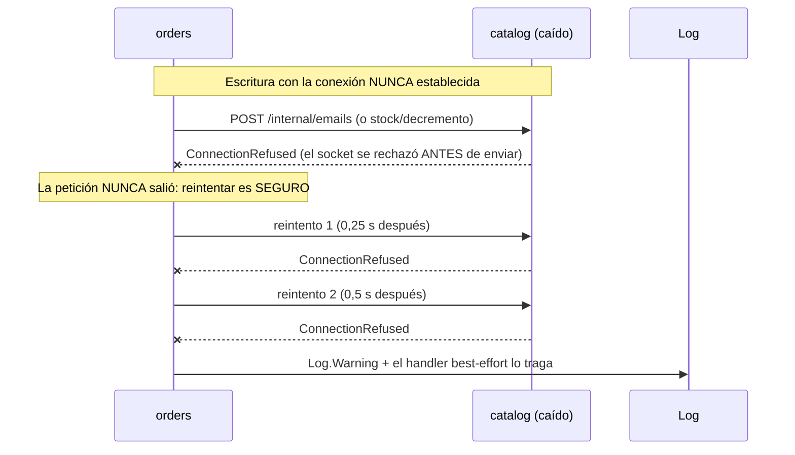
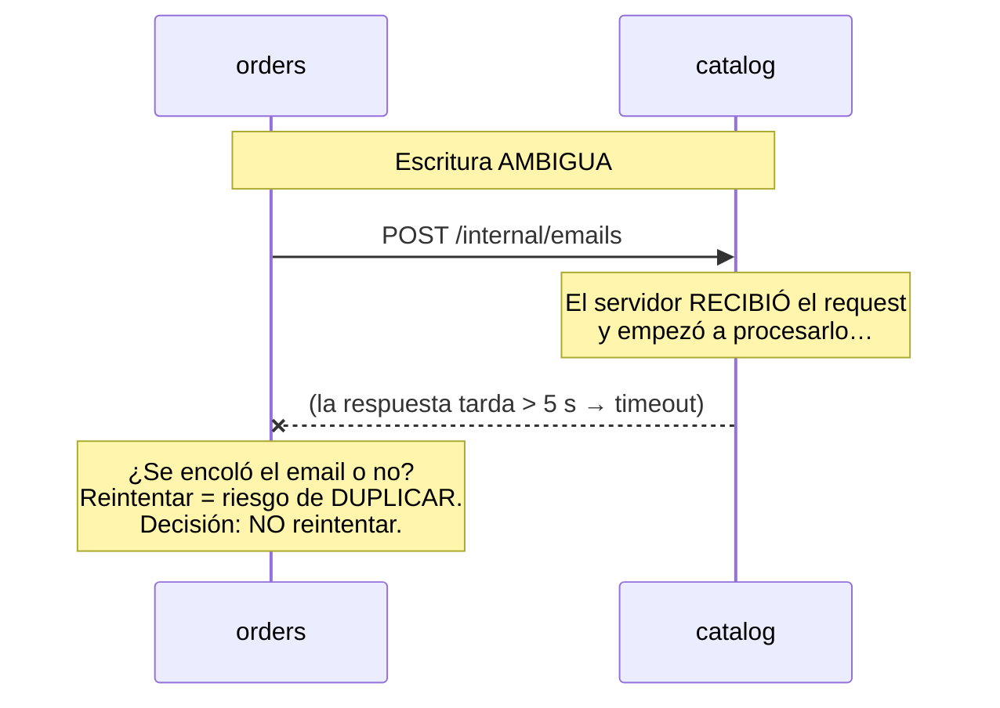

# 37. Resiliencia entre servicios (Polly)

> **Documento nuevo en la variante de microservicios.** En el monolito, un fallo
> interno era una excepción en el mismo proceso; entre microservicios, un backend
> caído o colgado **no debe** bloquear al que lo llama. Este es el motivo de
> existir de `BuildingBlocks/Http/`.

## Índice

- [37.1. El problema: el timeout por defecto de HttpClient](#371-el-problema-el-timeout-por-defecto-de-httpclient)
- [37.2. Los tres conceptos: timeout, retry y cortacircuitos](#372-los-tres-conceptos-timeout-retry-y-cortacircuitos)
- [37.3. La política: decide el verbo de la petición](#373-la-política-decide-el-verbo-de-la-petición)
- [37.4. Circuitos por autoridad, no globales](#374-circuitos-por-autoridad-no-globales)
- [37.5. Cómo se integra: el DelegatingHandler](#375-cómo-se-integra-el-delegatinghandler)
- [37.6. Cadena de ejecución](#376-cadena-de-ejecución)
- [37.7. Por qué un POST no se reintenta](#377-por-qué-un-post-no-se-reintenta)
- [37.8. Medición real](#378-medición-real)
- [37.9. Los tests](#379-los-tests)

## 37.1. El problema: el timeout por defecto de HttpClient

Sin protección, cuando `catalog` (o cualquier servicio) se caía:

- Cada llamada se quedaba esperando hasta el **timeout por defecto de
  `HttpClient`: 100 segundos**.
- `statistics`, que encadena páginas de **varios dueños** en una sola vista,
  multiplicaba ese tiempo (varios × 100 s).
- El cliente (usuario o suite E2E) veía la petición **colgada**, no un error
  rápido.

> 🎓 **La regla de oro de la resiliencia**: *fallar rápido es mejor que colgar*.
> Un error en 27 ms permite reintentar, mostrar un mensaje o servir una caché;
> un cuelgue de 100 s agota al usuario y a los pools de conexiones.

## 37.2. Los tres conceptos: timeout, retry y cortacircuitos

| Concepto | Qué hace | Analogía |
| --- | --- | --- |
| **Timeout** | Corta cada intento si tarda más de lo debido | El tiempo máximo que esperas a alguien al teléfono |
| **Retry** | Repite la petición si el fallo parece transitorio | Vuelves a llamar a los 30 segundos |
| **Circuit breaker** | Tras N fallos consecutivos, **deja de llamar** durante un tiempo y falla al instante | Si la centralita está caída, no sigues pulsando: esperas y pruebas más tarde |

En Polly v8 los tres se componen en un **pipeline** (`ResiliencePipeline`) donde
el orden importa (ver [37.6](#376-cadena-de-ejecución)).

## 37.3. La política: decide el verbo de la petición

La distinción clave de este proyecto es que la política **no mira el cliente,
mira el verbo HTTP de cada petición** (`request.Method`):

| Verbo | Timeout por intento | Reintento | Cortacircuitos |
| --- | --- | --- | --- |
| **GET / HEAD** | **10 s** | **2 reintentos** con backoff exponencial (0,25 s → 0,5 s + jitter) ante 5xx, 408, timeout o error de red | 5 fallos consecutivos → **15 s sin llamar** |
| **POST / PUT / DELETE** | **5 s** | **Solo si la conexión nunca se estableció** (ConnectionRefused / HostNotFound / NetworkUnreachable) | Ídem, **por autoridad** |
| **4xx** | — | **Nunca**: es error de negocio — el backend está sano y los `404`/`422` deben llegar a la primera | No cuenta como fallo |

**¿Por qué una regla tan conservadora en escrituras?**

```
POST /internal/productos/1/stock/decremento   →  204 OK (descontado)
        ¿y si la respuesta se pierde a mitad de camino?
        El servidor SÍ descontó. Reintentar →  ¿descuento doble?
```

Un reintento ciego de escritura puede **duplicar** un decremento de stock, un
email o un pedido. Por eso:

- **Timeout en escritura = ambiguo** (el servidor pudo recibir el request) →
  **sin reintento**.
- **5xx en escritura = ambiguo** (procesó y falló al responder) → **sin
  reintento**.
- **ConnectionRefused = seguro**: la petición **nunca salió** de este proceso
  (el socket fue rechazado antes de enviar) → **reintentar no duplica nada**.

> **Nota didáctica**: `ConnectionReset` (corte a mitad de respuesta) **no**
> cuenta como "nunca establecida" — el servidor pudo procesar el request. Es la
> misma duda que haría un humano.

## 37.4. Circuitos por autoridad, no globales

El estado del cortacircuitos se guarda **por autoridad de destino**
(`scheme://host:puerto`), no en un pipeline global:



**Por qué**: con un circuito **global**, si `catalog` cae, el circuito saltaría
también para las llamadas a `identity` (sano) — y statistics empezaría a fallar
contra **todos** los dueños. Con circuitos por autoridad, cada destino tiene su
propio estado: **cae uno, no arrastra a los demás**.

Los pipelines se cachean en un **singleton** por proceso
(`ResiliencePipelineProvider`): el estado del circuito debe sobrevivir a la
rotación de cadenas de handlers de `IHttpClientFactory` (~10 min), si no se
resetearía solo.

## 37.5. Cómo se integra: el DelegatingHandler

La integración es **una línea por cliente Refit** en el registro:

```csharp
services.AddRefitClient<ICatalogApi>()
    .ConfigureHttpClient(c => c.BaseAddress = new Uri(...))
    .AddHttpMessageHandler<AuthorizationForwardingHandler>()  // ← el JWT viaja una vez
    .AddTiendaResilience();                                   // ← T12.6: la resiliencia
```

**¿Por qué un handler propio y no `AddResilienceHandler` de YARP/Polly?**
Porque `AddResilienceHandler` construye **un pipeline por client** y su
`ShouldHandle` solo ve el `Outcome<HttpResponseMessage>` (respuesta o
excepción): **no puede saber si la petición era un GET o un POST cuando falla
con excepción** — que es justo la distinción de idempotencia. El
`DelegatingHandler` ve `request.Method` directamente.

**Orden en la cadena de handlers** (de fuera hacia dentro):

```
petición → ResilienceDelegatingHandler (retry/timeout/circuito)
        → AuthorizationForwardingHandler (pone el JWT una vez)
        → HttpClientHandler (red)
```

Si el retry se dispara, la cabecera **ya está en el request** (y el handler de
auth la guarda con `Contains`), así que no se duplica en ningún orden.

## 37.6. Cadena de ejecución

Dentro del pipeline de una petición concreta, de fuera hacia dentro:



**Estados del cortacircuitos** (mismo patrón que el pipeline de emails del
monolito):

| Estado | Comportamiento |
| --- | --- |
| **CERRADO** | Deja pasar; cuenta los fallos consecutivos |
| **ABIERTO** | Tras **5 fallos** en una ventana de 60 s → **15 s sin llamar**: las llamadas fallan al instante con `BrokenCircuitException` (sin tocar la red) |
| **HALF-OPEN** | Al terminar el tiempo, deja pasar **una** llamada de prueba: si pasa → CERRADO; si falla → ABIERTO otra vez |

## 37.7. Por qué un POST no se reintenta



Y el caso contrario, **por qué NO se reintenta un timeout en escritura**:



## 37.8. Medición real

Con `catalog` caído y una llamada encadenada a statistics:

| Momento | Tiempo |
| --- | --- |
| **Antes de T12.6** (timeout por defecto) | hasta **100 000 ms** colgada |
| **1ª llamada con la política** (paga los reintentos) | **9 199 ms** |
| **Siguientes llamadas** (circuito ABIERTO, falla en ms) | **~27 ms** |

Y el smoke de caída de `email` al crear un pedido:

| Momento | Resultado |
| --- | --- |
| **Antes** | `500` con el pedido **ya guardado** y el stock **ya descontado** (incoherencia) |
| **Ahora** | **`201` en 4,4 s**: los dos handlers de email atrapan la caída con `Log.Warning` (mejor esfuerzo) y el pedido sale correctamente |

## 37.9. Los tests

`BuildingBlocks.Tests/Unit/Http/RefitResilienceTests.cs` — **28 tests** que
cubren los tres comportamientos críticos:

- **Idempotencia por verbo**: GET reintenta (1 + 2 intentos); POST ante 5xx hace
  **un solo** intento.
- **Nunca 4xx**: los `404`/`422` llegan a la primera, intactos.
- **Conexión nunca establecida**: `ConnectionRefused`/`HostNotFound` → reintento
  en escritura; `ConnectionReset` o excepción sin socket → **sin** reintento.
- **Cortacircuitos**: tras los 5 fallos, `BrokenCircuitException` **sin invocar
  el callback** (la red no se toca).
- **Aislamiento por autoridad**: mismas autoridad → mismo pipeline; autoridades
  distintas → circuitos aislados.
- **Timeout**: el callback debe observar el `CancellationToken` (como hace
  `HttpClient.SendAsync`) para que el timeout pueda cancelarlo.

```bash
dotnet test BuildingBlocks.Tests/BuildingBlocks.Tests.csproj
# → 28/28 en ~141 ms
```

---

**Ver también**: [35 · Arquitectura de microservicios](35-arquitectura-microservicios.md) ·
[38 · Comunicación entre microservicios](38-comunicacion-microservicios.md) ·
[23 · Email Services](23-email-services.md)
