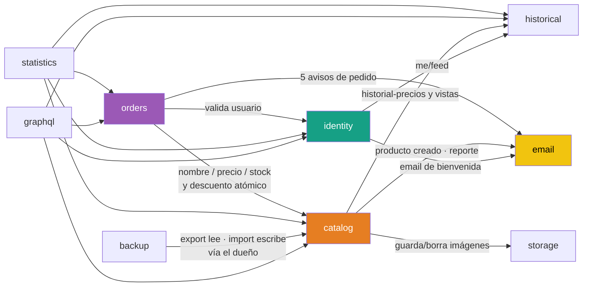
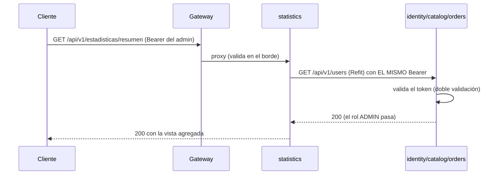

# 38. Comunicación entre microservicios

> **Documento nuevo en la variante de microservicios.** En el monolito todo
> hablaba en memoria (llamadas a métodos, eventos de dominio con `MediatR`).
> Repartido en procesos, esa comunicación pasa a ser **red** — y eso cambia las
> reglas del juego.

## Índice

- [38.1. Dos canales, cada uno para lo suyo](#381-dos-canales-cada-uno-para-lo-suyo)
- [38.2. REST con Refit: contratos tipados](#382-rest-con-refit-contratos-tipados)
- [38.3. Mapa de dependencias](#383-mapa-de-dependencias)
- [38.4. Rutas internas: solo red interna](#384-rutas-internas-solo-red-interna)
- [38.5. El JWT viaja en cada llamada](#385-el-jwt-viaja-en-cada-llamada)
- [38.6. Mejor esfuerzo: cuando el destinatario no responde](#386-mejor-esfuerzo-cuando-el-destinatario-no-responde)
- [38.7. Qué NO se usa (y por qué)](#387-qué-no-se-usa-y-por-qué)

## 38.1. Dos canales, cada uno para lo suyo

| Canal | Para qué | Ejemplos |
| --- | --- | --- |
| **REST con Refit** | **Toda** la comunicación entre servicios: validaciones, lecturas agregadas, export/import, histórico, emails | orders → catalog (nombre/precio/stock); backup → catalog (importación); statistics → todos |
| **SignalR** | **Solo hacia el navegador**: tiempo real de negocio | hubs `productos` (en catalog) y `pedidos` (en orders) — el **gateway hace de proxy** |

> **Por qué no SignalR entre servicios**: es transporte de tiempo real para
> clientes, no un canal de llamadas de negocio. La "automatización" interna
> (jobs de fondo) vive **dentro** de cada servicio, no entre ellos.

## 38.2. REST con Refit: contratos tipados

[Refit](https://github.com/reactiveui/refit) genera un **cliente tipado a partir
de una interfaz**: lo que en el monolito era `_catalogRepository.GetByIdAsync()`,
aquí es una llamada HTTP declarada como interfaz C#.

**1 · El contrato** (vive en el servicio **llamante**, no se comparte):

```csharp
// En Orders: contrato con el dueño de los productos
public interface ICatalogApi
{
    [Get("/api/v1/productos/{id}")]
    Task<ProductoSnapshot> GetProductoAsync(long id, CancellationToken ct = default);

    [Post("/internal/productos/{id}/stock/decremento")]
    Task DecrementarStockAsync(long id, DecrementoStockDto dto, CancellationToken ct = default);
}
```

**2 · El registro** (en `Program.cs` o `ServicesConfig` del llamante):

```csharp
services.AddRefitClient<ICatalogApi>()
    .ConfigureHttpClient(c => c.BaseAddress =
        new Uri(configuration["Services:Catalog"] ?? "http://localhost:5105"))
    .AddHttpMessageHandler<AuthorizationForwardingHandler>()  // reenvía el JWT
    .AddTiendaResilience();                                   // ver doc 37
```

**3 · El uso** (parece una llamada local, pero es red):

```csharp
var producto = await catalogApi.GetProductoAsync(id, ct);   // GET → catalog:5105
```

| Aspecto | Decisión |
| --- | --- |
| **Direcciones** | Por configuración (`Services:*`): en Docker el nombre del contenedor, en local `localhost:{puerto}` |
| **Contratos** | Cada servicio declara **sus** interfaces `I*Api` — sin proyecto compartido de contratos (evita acoplamiento) |
| **Resiliencia** | Cada cliente lleva la política de [37](37-resiliencia-polly.md) (`.AddTiendaResilience()`) |
| **Auth** | El llamante **reenvía el JWT** del usuario original (nunca inventa identidad) |

## 38.3. Mapa de dependencias



**Lectura**: `catalog` es el nodo más consultado (es el dueño del catálogo);
`statistics` y `graphql` son **agregadores puros** (leen a todos);
`email` y `historical` son **hojas**: nadie depende de ellos para una
respuesta (los avisos son mejor esfuerzo y el histórico es complementario).

**Regla de dependencias**: los grafos **no tienen ciclos de negocio** — un
servicio no depende de otro que dependa de él en la misma operación (los ciclos
que sí existen, como orders→catalog→historical, son de lectura secundaria).

## 38.4. Rutas internas: solo red interna

Las operaciones **entre servicios** usan prefijos `/internal/*` que **no se
publican en el gateway** (ver [36](36-api-gateway-yarp.md)):

| Método | Ruta | Consumidor | Acción |
| --- | --- | --- | --- |
| GET | `/internal/users/{id}` (identity) | orders | Existe y no está borrado (404 → pedido rechazado) |
| GET | `/internal/users/activos` (identity) | catalog | Usuarios activos (reporte semanal) |
| POST | `/internal/productos/{id}/stock/decremento` (catalog) | orders | Descuento atómico con validación: `204` ok · `404` · `422` stock insuficiente |
| POST | `/api/catalog/internal/{productos,categorias,proveedores}/import` (catalog) | backup | Upsert por clave con IDs explícitos |
| POST · DELETE | `/internal/storage/files` (storage) | catalog | Guarda/borra imágenes |
| POST | `/internal/emails` (email) | identity, orders, catalog | Encola avisos (responde `202` y encola) |
| GET · POST | `/internal/historial/*` (historical) | catalog, identity | Serie de precios, feed y escritura del dual-write |

**Por qué prefijos distintos** (`/internal/…` y `/api/catalog/internal/…`):
cada servicio es dueño de su espacio de rutas; el prefijo largo de catalog
(`/api/catalog/internal/…`) convive con sus rutas públicas (`/api/v1/…`) sin
colisionar.

> 🎓 **Regla de seguridad (R7)**: aunque una ruta interna estuviera mal
> configurada en el gateway, **no existe ninguna fila** que la enrute → el
> endpoint es inalcanzable desde el exterior. Solo la red Docker lo resuelve.

## 38.5. El JWT viaja en cada llamada

El usuario autentica **una vez** contra el gateway, pero los servicios internos
necesitan saber **quién** pide qué (por ejemplo, `GET /api/v1/pedidos` exige
ADMIN):



- El cliente de Refit lleva `AuthorizationForwardingHandler`: **copia** la
  cabecera del request entrante al llamado — jamás fabrica un token.
- Si el llamante es **anónimo** (sin cabecera), la llamada interna sale sin
  token: los endpoints internos que no requieren auth la aceptan.

## 38.6. Mejor esfuerzo: cuando el destinatario no responde

No todo fallo puede frenar la operación principal. Criterio: **la respuesta al
usuario no depende de un servicio secundario**.

| Operación | Si el destinatario cae |
| --- | --- |
| **Aviso de email** (`POST /internal/emails`) | `try/catch` + `Log.Warning` en el handler: el pedido, el registro o el producto **se crean igual** (mejor esfuerzo, como en el monolito) |
| **Validación de usuario / stock** | **Sí** se propaga el error: sin verificar, no se crea el pedido (fail-closed) |
| **Histórico / feed** | Lectura complementaria: si `historical` cae, la vista de histórico falla pero el producto se sirve |

**El ejemplo del email en pedidos**: al crear un pedido se disparan dos avisos
(admin y cliente). Si `email` está caído:

```
[13:04:47 WRN] PedidoCreadoClienteEmailHandler: email-service no disponible, no se encoló el aviso
[13:04:56 WRN] PedidoCreadoEmailHandler: email-service no disponible, no se encoló el aviso
[13:04:56 INF] HTTP POST /api/v1/pedidos/me responded 201   ← el pedido SALE
```

La política de resiliencia ([37](37-resiliencia-polly.md)) hace el trabajo
sucio (timeouts, reintentos seguros, circuito) y el `try/catch` del handler
decide que **el negocio no puede esperar al correo**.

## 38.7. Qué NO se usa (y por qué)

| Tecnología | Por qué no está |
| --- | --- |
| **Colas de mensajes** (RabbitMQ…) | Fuera de alcance didáctico: la infraestructura y la teoría de entrega no se cubren en 2DAW |
| **gRPC** | REST con Refit unifica el transporte: un solo estilo de llamada para todo el proyecto |
| **Event bus / Sagas** | Sin bus no hay eventos entre servicios: la comunicación es **explícita y synchronous** (y se documenta como limitación) |
| **Eventos de dominio entre servicios** | Los domain events de MediatR siguen existiendo, pero **dentro** de un servicio (p.ej. catalog: PostgreSQL → read model). Entre servicios no cruzan procesos |
| **Headers `X-User-Id`** | La identidad viaja en el **propio `Authorization: Bearer`**: mismo token, mismo significado, sin identidad falsificable |

**La contrapartida asumida**: al llamar de forma síncrona, si un servicio
dependiente está caído, la operación que lo necesita **falla** (o se degrada si
es mejor esfuerzo). Por eso la resiliencia de [37](37-resiliencia-polly.md) no
es opcional: es lo que hace usable la arquitectura.

---

**Ver también**: [35 · Arquitectura de microservicios](35-arquitectura-microservicios.md) ·
[36 · API Gateway (YARP)](36-api-gateway-yarp.md) ·
[37 · Resiliencia (Polly)](37-resiliencia-polly.md)
